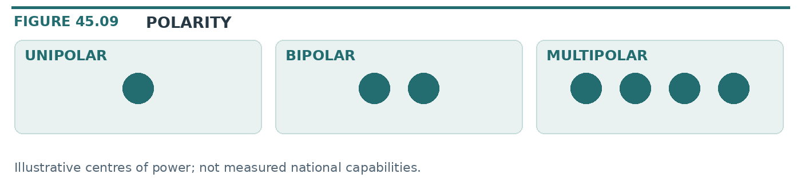

Polarity describes the number of major centres of power in a system. Unipolarity denotes one predominant centre; bipolarity describes two principal centres; multipolarity describes several. These categories are simplifications, not official legal statuses. The Cold War is often described as bipolar because the United States and Soviet Union were the major competing centres, but China, nonaligned states and regional powers still exercised agency.

The number of poles depends partly on what is being measured. A state may be globally influential militarily while another region exercises considerable economic or regulatory power. A system can appear more concentrated in one domain than another. The relevant unit might be a state, a relatively cohesive group of states or an institution with delegated powers. Counting flags does not identify centres of independent decision-making.

There is no uncontested answer to which polarity is safest. Two dominant actors may simplify certain relationships while concentrating the stakes of conflict. Multiple centres may provide more diplomatic options while making intentions and commitments harder to interpret. Institutional rules, geography, historical grievances and domestic politics condition these effects. A confident claim that a particular number of poles guarantees peace should invite the same scrutiny as the deterministic claims in Chapter 43.

<figure class="figure" id="figure-45-9">

<figcaption>Figure 45.9. Illustrative centres of power; not measured national capabilities. <a class="figure-anchor" href="#figure-45-9" aria-label="Link to this figure">#</a></figcaption>
</figure>
