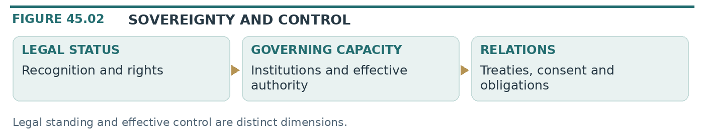

The Peace of Westphalia in 1648 ended major conflicts within the Holy Roman Empire and between European powers. It is often presented as the moment the modern system of sovereign states was born. The story is convenient for a textbook timeline, but it compresses a much longer and more uneven history. The Empire continued to exist with overlapping authorities, and European powers exercised authority overseas through empires, trading companies and colonial conquest. Historian Andreas Osiander argues against treating the settlements as the simple foundation of modern sovereignty. \[<a href="/045-diplomacy-alliances-and-balance-of-power/sources/#source-5" class="cite">5</a>\]

Sovereignty concerns the authority of a political community to govern itself and its standing in relation to others. It is useful to distinguish legal status from effective control. A recognised state may struggle to administer parts of its territory; an entity may control territory without widespread recognition as a state. International recognition, membership of organisations and diplomatic relations are related but not identical. A state can withhold recognition or diplomatic relations for legal or political reasons.

The international system is sometimes called anarchic because it lacks a single government with universal authority over states. This does not mean that no rules exist. Treaties, customary law, institutions, economic relationships and reputations constrain behaviour. The absence of a central sovereign explains some problems of enforcement; it does not license aggression or excuse violations of international law. \[<a href="/045-diplomacy-alliances-and-balance-of-power/sources/#source-6" class="cite">6</a>\]

<figure class="figure" id="figure-45-2">

<figcaption>Figure 45.2. Legal standing and effective control are distinct dimensions. <a class="figure-anchor" href="#figure-45-2" aria-label="Link to this figure">#</a></figcaption>
</figure>
