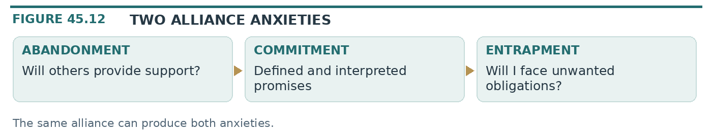

Glenn Snyder identifies a tension within alliances. A member can fear abandonment, meaning a partner might fail to provide expected support when it matters. It can also fear entrapment, meaning it might be pulled into a confrontation it would otherwise avoid. Reassurance that reduces one anxiety can increase the other if partners believe they will receive unconditional backing. \[<a href="/045-diplomacy-alliances-and-balance-of-power/sources/#source-16" class="cite">16</a>\]

Consider a fictional association of three coastal towns that agree to provide emergency assistance. A town fears its partners will not help during a flood. Its partners worry that they will be expected to finance projects outside the agreement. Clear definitions of responsibilities, regular review and legitimate decision procedures may reduce confusion, but the members can still disagree over exceptional situations. The analogy illustrates competing expectations, not a model of actual armed commitments.

Alliances manage the dilemma through political and institutional practices, not through a single perfect contract. Treaty wording, consultation, national decision-making procedures and the history of cooperation all matter. The analyst should distinguish fears from outcomes. Evidence that a government expressed concern about abandonment does not prove that abandonment would have occurred. Evidence of a dispute among allies does not demonstrate that their entire relationship has collapsed.

<figure class="figure" id="figure-45-12">

<figcaption>Figure 45.12. The same alliance can produce both anxieties. <a class="figure-anchor" href="#figure-45-12" aria-label="Link to this figure">#</a></figcaption>
</figure>
