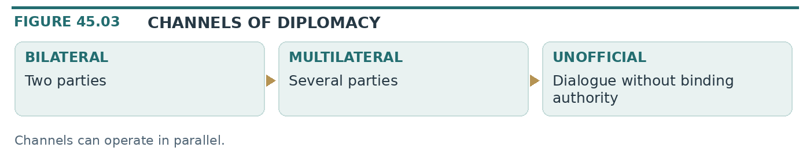

Bilateral diplomacy occurs between two parties; multilateral diplomacy brings several together. A meeting between two foreign ministers is bilateral even if it takes place at a large conference. Negotiations in the United Nations are multilateral, but delegates still conduct bilateral consultations in the margins. The distinction matters because a bilateral agreement may be easier to tailor, while a multilateral arrangement can address problems that no two governments can solve alone.

Public diplomacy communicates with foreign publics rather than only with officials. Cultural exchanges, scholarships and public explanations of policy can shape trust. They can also be perceived as propaganda. A claim of cultural friendship is not evidence that the audience actually finds the message persuasive. Track II diplomacy, conducted by unofficial participants, can explore ideas that authorised officials cannot yet endorse; it should not be mistaken for an official agreement.

Back-channel contacts may allow governments to explore compromises without immediate publicity, while formal negotiations create records and support accountability. Secrecy can be useful for candid discussion but can also conceal exclusions and commitments from people entitled to scrutiny. The question is not whether secrecy is always good or bad; it is what institutional purpose it serves, who authorised it, and whether the resulting obligations can be implemented legitimately.

<figure class="figure" id="figure-45-3">

<figcaption>Figure 45.3. Channels can operate in parallel. <a class="figure-anchor" href="#figure-45-3" aria-label="Link to this figure">#</a></figcaption>
</figure>
