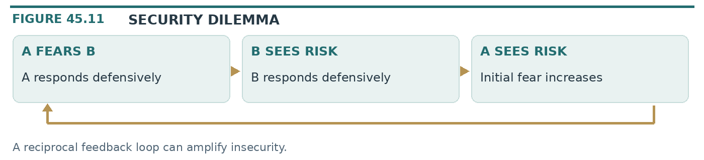

A government fears its neighbour and increases its capacity for defence. The neighbour sees increased capability but cannot be sure about future intentions. It responds by expanding its own capacity. The first government interprets this as confirmation of its original fear. Both can end up feeling less secure despite believing that their actions are protective. Robert Jervis's research analyses conditions under which such reciprocal insecurity becomes more or less severe. \[<a href="/045-diplomacy-alliances-and-balance-of-power/sources/#source-15" class="cite">15</a>\]

This mechanism is a feedback loop, linking Chapter 7's systems thinking with geopolitics. Its intensity depends on information, historical experience, the character of capabilities and how reliably restraint can be observed. A diplomatic relationship that clarifies intentions may reduce some uncertainty, but no communiqué can prove every future government's intentions. Existing distrust may cause even genuinely conciliatory actions to be interpreted suspiciously.

Not every rivalry is a security dilemma. Some actors seek territorial expansion or domination; some disputes reflect real incompatibilities rather than misunderstanding. Calling aggression a mutual spiral without examining evidence can obscure responsibility. The analytical task is to distinguish defensive motives, aggressive goals, perception and conduct, remembering that motives do not remove legal obligations. A theory describing how insecurity grows is not a claim that all parties bear equal blame.

<figure class="figure" id="figure-45-11">

<figcaption>Figure 45.11. A reciprocal feedback loop can amplify insecurity. <a class="figure-anchor" href="#figure-45-11" aria-label="Link to this figure">#</a></figcaption>
</figure>
