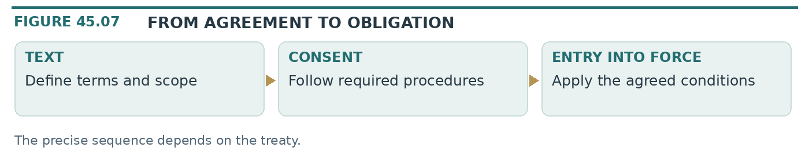

A treaty is an international agreement governed by international law; its label is not decisive. The Vienna Convention on the Law of Treaties of 1969 addresses written treaties between states and codifies important rules about consent, interpretation and performance. A memorandum can be binding or nonbinding depending on its terms and circumstances. A joint declaration may express policy rather than legal obligations. Neither a formal title nor a ceremonial signature settles every legal question.

Signing, ratifying and entering into force are distinct steps. Some agreements bind parties upon signature; others require ratification or additional conditions. Domestic approval and international consent have different functions. A state may be required to complete constitutional procedures before ratification. The entry-into-force clause then determines when the treaty becomes operative. Reservations, withdrawal provisions and dispute-settlement clauses can affect the scope of commitments.

When reading a diplomatic headline, locate the actual text if possible. Identify the parties, the legal status, conditions, territorial scope, duration and the specific verbs expressing obligations. Is the agreement promising consultation, cooperation or mutual assistance? Is it effective immediately? The surrounding press conference is relevant evidence about political intent, but it is no substitute for the document itself. \[<a href="/045-diplomacy-alliances-and-balance-of-power/sources/#source-10" class="cite">10</a>\]\[<a href="/045-diplomacy-alliances-and-balance-of-power/sources/#source-46" class="cite">46</a>\]

<figure class="figure" id="figure-45-7">

<figcaption>Figure 45.7. The precise sequence depends on the treaty. <a class="figure-anchor" href="#figure-45-7" aria-label="Link to this figure">#</a></figcaption>
</figure>
