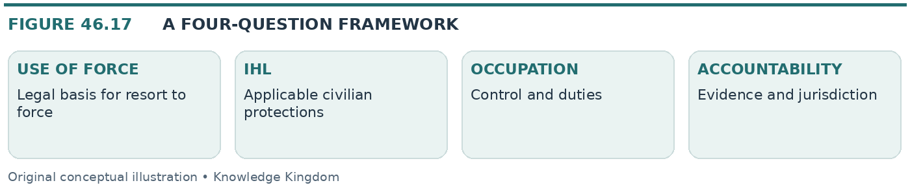

Suppose two fictional states, Eastmere and Westmere, share a river valley. Their governments dispute a water allocation agreement. Eastmere's authorities eventually send armed forces across the recognized border without Westmere's consent. They claim that the water dispute endangers their economic security. An impartial relief organization reports that a hospital is overwhelmed, several families have disappeared from public records, and displaced residents cannot obtain sufficient medicine. A third state proposes sending supplies and asks an international body to examine the situation. No real country is represented by this example.

The first legal inquiry concerns the resort to force. A water dispute and economic insecurity do not themselves establish an armed attack or a legal entitlement to invade. Identify the Charter rule and any claimed exception rather than simply asking which country appears more sympathetic. The second inquiry concerns humanitarian law. Armed force between states creates an international armed conflict; people affected by it are entitled to applicable protections independently of the interstate dispute. The third inquiry concerns the state obligations of any authority exercising effective control over foreign territory. Those duties depend on the facts of control, not on the authority's declaration of sovereignty.

The fourth inquiry concerns accountability. An investigator would need to distinguish reliable reports from unverified allegations, document each relevant obligation, identify any responsible state or individual and establish the jurisdiction of the institution asked to act. A hospital's report can show urgent needs without establishing every element of a criminal charge. Immediate humanitarian assistance need not await a trial. The four inquiries are connected but none can substitute for the others. If you can keep them separate while recognizing how they interact, you have acquired a valuable method for understanding news about armed conflict.

<figure class="figure" id="figure-46-17">

<figcaption>Figure 46.17. The fictional river-valley case combines four distinct legal inquiries. <a class="figure-anchor" href="#figure-46-17" aria-label="Link to this figure">#</a></figcaption>
</figure>
