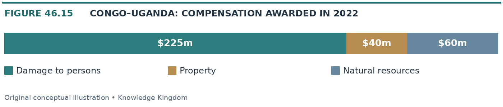

In 2005 the ICJ found that Uganda had breached international obligations in the Democratic Republic of the Congo, including rules on the use of force and obligations arising from its conduct in occupied territory. The dispute did not end with that judgment. In 2022 the Court fixed compensation at a total of US$325 million, divided into $225 million for damage to persons, $40 million for property damage and $60 million concerning natural resources. \[<a href="/046-international-law-and-armed-conflict/sources/#source-48" class="cite">48</a>\]

The categories show that the harm of war cannot be represented solely by lost equipment or damage to government buildings. People suffer injury, displacement, lost homes and destroyed livelihoods. Natural resources may be exploited during conflict; this can alter economic relations and deprive communities of future benefits. Quantifying such damage years later involves difficult evidentiary problems. Compensation is a legal response, not an assertion that money can replace a person's life or erase the past.

The interval between the 2005 judgment and the 2022 reparations decision also demonstrates that courts operate on a different timescale from political crises. A ceasefire, peace settlement, judgment and actual payment can all happen at different times. Whether reparation reaches the people for whom it is intended is an additional question. The broader lesson is that the end of active fighting does not end the legal consequences of a conflict. Chapters 49 and 50 will return to the relationship between historical injury, reparations, political institutions and reconstruction.

<figure class="figure" id="figure-46-15">

<figcaption>Figure 46.15. US$325 million in judicial compensation, divided into three categories. Source: ICJ \[48\]. <a class="figure-anchor" href="#figure-46-15" aria-label="Link to this figure">#</a></figcaption>
</figure>
