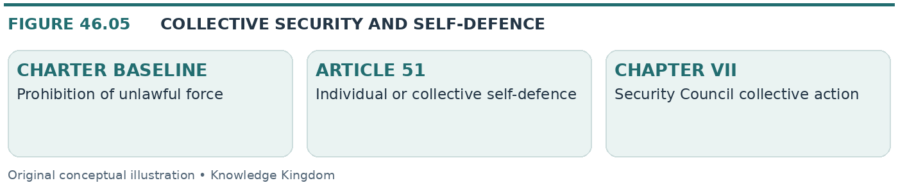

Chapter VII of the Charter gives the Security Council authority to determine threats to peace, breaches of peace and acts of aggression. It may adopt measures not involving armed force, such as specified sanctions, and may authorize force where the Charter's conditions are satisfied. Council resolutions differ in language, legal foundation, scope and duration. The phrase authorizing all necessary means is often associated with a permission to use force, but the whole resolution must be read in context. \[<a href="/046-international-law-and-armed-conflict/sources/#source-4" class="cite">4</a>\]

A historical example is the response to Iraq's invasion of Kuwait in 1990. Resolution 678 authorized cooperating member states, subject to its conditions, to use force to implement earlier resolutions and restore peace and security in the area. This demonstrates that collective authorization can be given without making an alliance the supreme legal authority. It does not imply that every later operation in the same region was automatically authorized. \[<a href="/046-international-law-and-armed-conflict/sources/#source-17" class="cite">17</a>\]

The five permanent members' veto power can prevent substantive Council action. The General Assembly may debate and recommend collective measures, including through emergency special sessions, but its resolutions generally do not supply the same legal authority as a Chapter VII authorization. Nor is the absence of a condemnation by the Council proof of legality. These distinctions show the tension at the heart of the UN: it was designed to regulate international power while embedding the political privileges of certain powerful states.

<figure class="figure" id="figure-46-5">

<figcaption>Figure 46.5. These legal routes are not interchangeable with political approval. <a class="figure-anchor" href="#figure-46-5" aria-label="Link to this figure">#</a></figcaption>
</figure>
