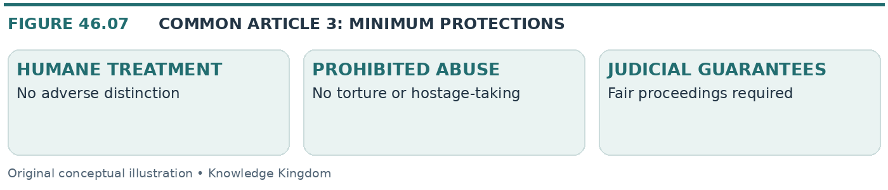

The four 1949 Geneva Conventions contain an identical Article 3, often called Common Article 3. It establishes minimum treatment obligations in armed conflicts not of an international character. People who are not actively taking part in hostilities, including fighters who have laid down their arms or are otherwise out of combat, must be treated humanely without prohibited adverse distinctions. Among the prohibited practices are murder, torture, hostage-taking, degrading treatment and sentencing or execution without the required judicial safeguards. \[<a href="/046-international-law-and-armed-conflict/sources/#source-24" class="cite">24</a>\]

The Article is particularly important because internal conflicts were historically treated as matters of domestic jurisdiction. Its application does not confer recognition, statehood or a political entitlement on an armed group. A state may continue to prosecute criminal offenses under its domestic law, subject to applicable safeguards. The humanitarian obligation exists independently of those political and criminal-law questions.

Imagine a village resident detained by an organized armed group because the group suspects political disloyalty. The group's lack of diplomatic recognition does not mean that the person has no protection under humanitarian law. Nor does the group's obligation to comply depend on whether the government honors its own obligations. The floor is meant to prevent a downward spiral in which each side excuses its cruelty by pointing to the other's conduct. Common Article 3 is brief, but its institutional significance is enormous: even civil war is not a legally empty space.

<figure class="figure" id="figure-46-7">

<figcaption>Figure 46.7. Basic safeguards apply to people not actively participating in hostilities. <a class="figure-anchor" href="#figure-46-7" aria-label="Link to this figure">#</a></figcaption>
</figure>
