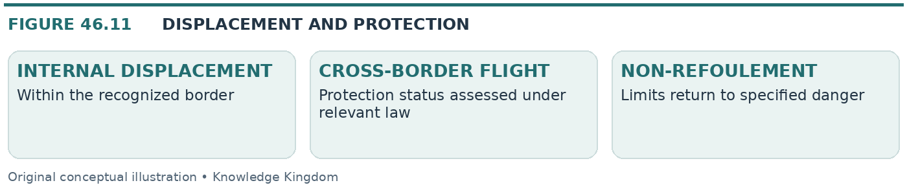

A family forced to leave home because of fighting may become internally displaced if it remains within its country. If it crosses a border, it may qualify for refugee status or another form of international protection, depending on the applicable definition and circumstances. The 1951 Refugee Convention centers on a well-founded fear of persecution for specified reasons; regional instruments and complementary protection regimes may address broader threats connected with conflict and violence. Not every person escaping war has identical legal status. \[<a href="/046-international-law-and-armed-conflict/sources/#source-32" class="cite">32</a>\]\[<a href="/046-international-law-and-armed-conflict/sources/#source-33" class="cite">33</a>\]

The principle of non-refoulement limits returning people to places where they face certain serious dangers. The precise scope and exceptions depend on the applicable body of law; the prohibition on return to a real risk of torture under human rights law is particularly strict. Refugee law, humanitarian law and human rights law may overlap, but they must not be collapsed into one legal regime. One can be displaced without being a refugee in the treaty sense, and one can be a refugee long after the armed conflict that initially caused flight has ended.

Forced displacement is itself restricted by humanitarian law. Evacuation for genuinely applicable safety or imperative military reasons is different from permanent demographic engineering. Humanitarian evacuation does not entitle an authority to confiscate homes or deprive residents of other protections. The experiences of displaced people also illustrate a central lesson from Chapter 36: a population is not simply a marker on a political map. A person's home may be bound up with livelihood, family, memory and legal rights that survive movement across borders.

<figure class="figure" id="figure-46-11">

<figcaption>Figure 46.11. Legal categories differ; all displaced people retain applicable rights. <a class="figure-anchor" href="#figure-46-11" aria-label="Link to this figure">#</a></figcaption>
</figure>
