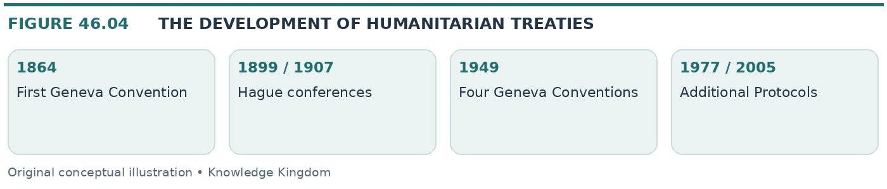

The Hague conferences of 1899 and 1907 produced treaties concerned in part with the conduct of warfare and the administration of occupied territory. The traditional distinction between Hague law, addressing how fighting is conducted, and Geneva law, addressing victims and protected persons, is a useful historical shorthand. Modern humanitarian law incorporates both and the categories overlap. \[<a href="/046-international-law-and-armed-conflict/sources/#source-11" class="cite">11</a>\]\[<a href="/046-international-law-and-armed-conflict/sources/#source-12" class="cite">12</a>\]

The catastrophes of the Second World War revealed immense gaps in the protection of civilians, prisoners and other people under enemy control. In 1949 governments adopted four Geneva Conventions. The first concerns wounded and sick armed forces on land; the second addresses wounded, sick and shipwrecked armed forces at sea; the third concerns prisoners of war; the fourth protects civilians in relevant circumstances, especially those in the power of an adverse party or occupying authority. Their provisions are much more detailed than these summaries suggest. \[<a href="/046-international-law-and-armed-conflict/sources/#source-2" class="cite">2</a>\]\[<a href="/046-international-law-and-armed-conflict/sources/#source-11" class="cite">11</a>\]

Two Additional Protocols were adopted in 1977, one focused chiefly on international conflicts and the other on certain internal conflicts. A third, adopted in 2005, introduced an additional distinctive emblem. The four Conventions have universal state participation; the Additional Protocols do not all have identical membership. The correct question is always which treaty provisions and customary rules apply to the parties and situation concerned. No slogan about the Geneva Conventions substitutes for that analysis. \[<a href="/046-international-law-and-armed-conflict/sources/#source-13" class="cite">13</a>\]

<figure class="figure" id="figure-46-4">

<figcaption>Figure 46.4. Timeline of selected milestones; many other treaties also matter. <a class="figure-anchor" href="#figure-46-4" aria-label="Link to this figure">#</a></figcaption>
</figure>
