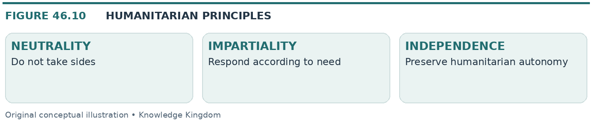

Humanitarian assistance aims to respond to suffering according to need. Organizations may provide food, medical support, shelter, sanitation, family tracing and other services. Their ability to operate depends not only on resources but on access to affected populations, security guarantees, and respect for their staff. Access is a legal and institutional issue rather than merely a problem of transporting donations. \[<a href="/046-international-law-and-armed-conflict/sources/#source-31" class="cite">31</a>\]

Under the applicable humanitarian rules, parties have primary responsibilities concerning civilian needs and must permit and facilitate qualifying impartial relief, subject to legally relevant conditions and rights of control. Consent requirements are not an unrestricted power to reject relief arbitrarily. In occupied territory, the Fourth Geneva Convention places specific obligations on the occupying power, including relief arrangements when the population is inadequately supplied. The precise treaty obligations depend on the conflict and circumstances. \[<a href="/046-international-law-and-armed-conflict/sources/#source-2" class="cite">2</a>\]\[<a href="/046-international-law-and-armed-conflict/sources/#source-31" class="cite">31</a>\]

A humanitarian organization is not necessarily endorsing a party when it negotiates access with that party. A refusal to communicate with a belligerent can sometimes make assistance impossible. Neutrality, impartiality and independence are distinct principles: neutrality concerns not taking sides in hostilities; impartiality concerns allocating help according to need; independence concerns the autonomy of humanitarian purposes from political or military objectives. They are institutional practices designed to make assistance credible across deep divisions, not statements that every political position is morally equal. \[<a href="/046-international-law-and-armed-conflict/sources/#source-54" class="cite">54</a>\]

<figure class="figure" id="figure-46-10">

<figcaption>Figure 46.10. Principled humanitarian access is not political endorsement. <a class="figure-anchor" href="#figure-46-10" aria-label="Link to this figure">#</a></figcaption>
</figure>
