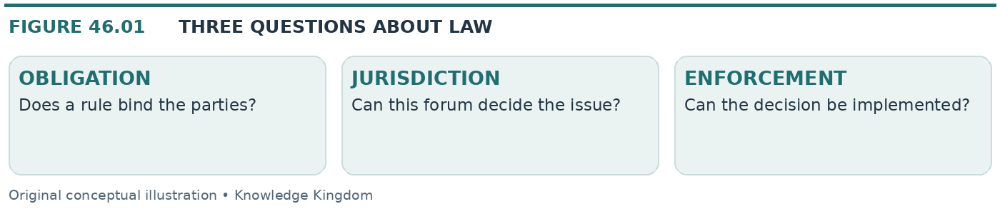

A person familiar with domestic law expects a legislature, police and courts. An international dispute rarely follows that pattern. There is no single worldwide legislature competent to enact ordinary criminal laws for every person, no universal police force, and no court with automatic jurisdiction over every dispute. The international legal order is comparatively decentralized. Yet its rules are not simply suggestions. Governments conclude treaties, recognize customary obligations, accept institutional decisions under particular instruments and regularly invoke law in their relations with other states. \[<a href="/046-international-law-and-armed-conflict/sources/#source-3" class="cite">3</a>\]\[<a href="/046-international-law-and-armed-conflict/sources/#source-4" class="cite">4</a>\]

Consider civil aviation. Aircraft belonging to one country routinely cross the territory of another, not because pilots are personally acquainted with foreign rulers but because governments and regulators operate within agreed frameworks. Diplomatic privileges, shipping, trade and border arrangements similarly make international obligations part of ordinary administration. The existence of spectacular breaches in wartime can conceal the far less spectacular daily operation of legal commitments.

Distinguish three questions. Is a rule legally binding? Can a particular institution decide whether it was broken? Can the resulting decision be enforced? A negative answer to the second or third does not necessarily negate the first. A person may owe a debt even when collecting it is difficult. Conversely, an institution may possess political power without being authorized to use it in a particular way. International law's distinctive weakness is often not an absence of obligations but the uneven distribution of authority and practical enforcement capacity.

<figure class="figure" id="figure-46-1">

<figcaption>Figure 46.1. A binding rule, a competent forum and effective enforcement are different things. <a class="figure-anchor" href="#figure-46-1" aria-label="Link to this figure">#</a></figcaption>
</figure>
