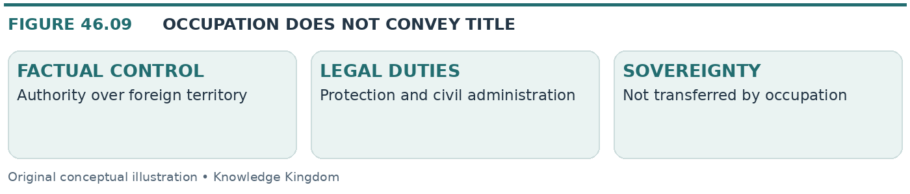

Occupation under humanitarian law is fundamentally a question about factual authority over foreign territory. The Hague Regulations of 1907 use the idea of territory placed under the authority of a hostile army. The ICRC describes the legal condition in terms of unconsented effective control, rather than a transfer of territorial sovereignty. An occupation can exist without active fighting at the particular place concerned. \[<a href="/046-international-law-and-armed-conflict/sources/#source-29" class="cite">29</a>\]\[<a href="/046-international-law-and-armed-conflict/sources/#source-30" class="cite">30</a>\]

An occupying power acquires duties because it exercises power over people who cannot rely on their ordinary government in the same way. The law requires respect for the population and imposes obligations concerning public order and civil life, health, essential supplies and the treatment of protected persons. It generally preserves existing laws subject to recognized exceptions and does not permit the occupier to treat the territory as its own sovereign property. The Fourth Geneva Convention restricts forced transfers and deportations and prohibits the occupying power from transferring parts of its own civilian population into occupied territory. \[<a href="/046-international-law-and-armed-conflict/sources/#source-2" class="cite">2</a>\]\[<a href="/046-international-law-and-armed-conflict/sources/#source-29" class="cite">29</a>\]

There is an important difference between the legality of maintaining a foreign presence and the duties that arise while that presence actually exists. Even where an occupation is unlawful, humanitarian obligations continue. A declaration of annexation does not remove protected status or erase the law of occupation. The doctrine exists because civilians should not lose protection whenever a dispute over the legal title to their home is unresolved. The longer an occupation continues, the greater the risk that a framework designed to regulate temporary authority becomes entangled with attempts at permanent political transformation.

<figure class="figure" id="figure-46-9">

<figcaption>Figure 46.9. Effective control gives rise to obligations without transferring sovereignty. <a class="figure-anchor" href="#figure-46-9" aria-label="Link to this figure">#</a></figcaption>
</figure>
