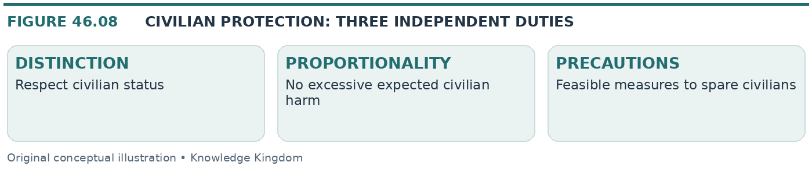

Humanitarian law forbids expected incidental civilian harm that would be excessive in relation to the concrete and direct military advantage anticipated from an attack. It also requires feasible precautions to avoid or minimize incidental civilian harm. These obligations operate alongside, not in place of, the principle of distinction. Direct attacks on civilians cannot be made lawful by arguing that they produce a worthwhile political benefit. \[<a href="/046-international-law-and-armed-conflict/sources/#source-12" class="cite">12</a>\]\[<a href="/046-international-law-and-armed-conflict/sources/#source-26" class="cite">26</a>\]

The legal proportionality inquiry is not an arithmetic ratio, and there is no universal permissible number of civilian deaths. A comparison of the number of people killed on opposite sides cannot establish by itself whether an incident was lawful. Conversely, the absence of observed casualties does not necessarily establish that every decision complied with the law. Proportionality is concerned with the expected harm and anticipated advantage in the circumstances, not merely the eventual outcome.

This distinction does not make outcomes irrelevant. The consequences of an incident can prompt investigation, reveal previously unknown information, or test whether explanations are credible. But the law must be applied using evidence of what was reasonably foreseeable, rather than simply converting hindsight into knowledge someone possessed earlier. Public reporting frequently lacks the necessary facts. A responsible reader can acknowledge grave civilian suffering, demand an independent investigation and refuse to claim certainty about every individual legal element until sufficient evidence exists. \[<a href="/046-international-law-and-armed-conflict/sources/#source-25" class="cite">25</a>\]\[<a href="/046-international-law-and-armed-conflict/sources/#source-26" class="cite">26</a>\]

<figure class="figure" id="figure-46-8">

<figcaption>Figure 46.8. These are complementary rules, not a numerical formula. <a class="figure-anchor" href="#figure-46-8" aria-label="Link to this figure">#</a></figcaption>
</figure>
