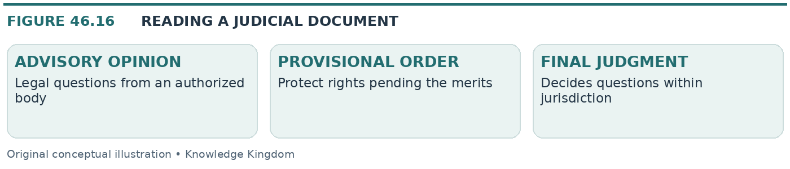

A dated legal document can be more informative than a stream of commentary. On 19 July 2024 the ICJ issued an advisory opinion concerning Israel's policies and practices in the Occupied Palestinian Territory, including East Jerusalem. The Court concluded, among other things, that Israel's continued presence there was unlawful and that it was obliged to bring that presence to an end as rapidly as possible. It addressed settlement policies, annexation-related practices, self-determination and obligations of other states. Some judges disagreed with parts of the reasoning or conclusions, as their separate opinions show. \[<a href="/046-international-law-and-armed-conflict/sources/#source-49" class="cite">49</a>\]

This advisory proceeding was distinct from the contentious case brought by South Africa against Israel under the Genocide Convention. In its order of 26 January 2024 in the latter case, the Court indicated binding provisional measures. Such measures aim to preserve rights pending the adjudication of the case; the order did not determine that genocide had been committed. It was not the same kind of document as the July advisory opinion. \[<a href="/046-international-law-and-armed-conflict/sources/#source-50" class="cite">50</a>\]

The point of this dated comparison is procedural literacy, not a full account of the conflict or a claim about the latest stage of proceedings. The events of 7 October 2023, hostage-taking, the humanitarian catastrophe in Gaza, the status of occupied territory and the parties' respective legal arguments raise overlapping but distinct questions. Civilian protections bind all relevant parties. The law does not permit abuses by one party to justify prohibited treatment by another. A reader should consult the relevant dated decisions, distinguish their procedural stages and avoid attributing to a court conclusions it has not actually reached.

<figure class="figure" id="figure-46-16">

<figcaption>Figure 46.16. The form and date of a decision tell you what it can establish. <a class="figure-anchor" href="#figure-46-16" aria-label="Link to this figure">#</a></figcaption>
</figure>
