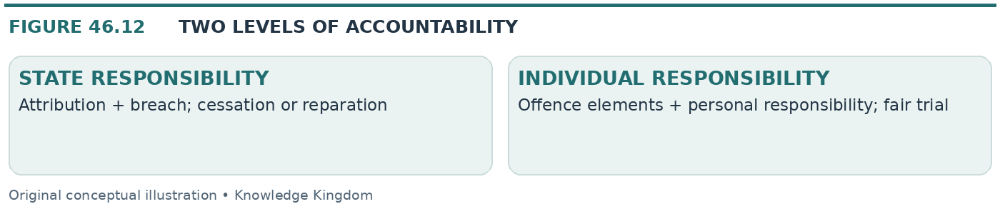

When a state breaches an international obligation through conduct attributable to it, international responsibility may arise. The International Law Commission's 2001 Articles on State Responsibility provide a widely used framework for these issues. They distinguish attribution, breach and the legal consequences of wrongful conduct. The Articles are not a treaty themselves; many of their provisions reflect customary law, while their exact status can require separate examination. \[<a href="/046-international-law-and-armed-conflict/sources/#source-41" class="cite">41</a>\]

Attribution asks whether conduct is legally treated as that of the state. Conduct by state organs is normally attributable to the state, but responsibility for the conduct of private actors or armed groups raises more complicated questions. Funding, political sympathy and legal attribution are not identical. A state may also breach an obligation of its own by failing to prevent prohibited conduct under circumstances where the relevant duty applies, even if the underlying acts are not attributable to it.

Consequences may include cessation, assurances of non-repetition where appropriate and reparation. Restitution attempts to restore the previous situation; compensation addresses assessable losses; satisfaction can include acknowledgment or a declaration of wrongdoing. These forms may be combined. An international judgment ordering compensation is different from a criminal sentence against an official. The injured state, affected people and accused individuals occupy distinct legal positions. A sound explanation specifies which kind of responsibility is being asserted rather than treating all accountability as one undifferentiated demand for punishment.

<figure class="figure" id="figure-46-12">

<figcaption>Figure 46.12. A finding against a state is not itself a criminal conviction. <a class="figure-anchor" href="#figure-46-12" aria-label="Link to this figure">#</a></figcaption>
</figure>
