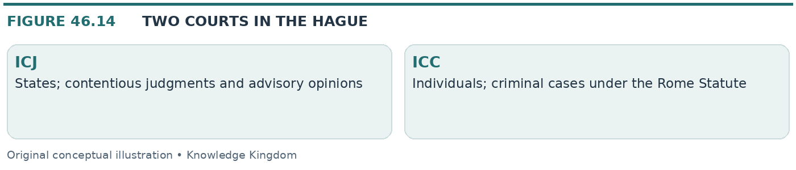

Both institutions sit in The Hague, which helps explain why news reports sometimes confuse them. The International Court of Justice (ICJ) is the UN's principal judicial organ and deals with contentious cases between states. It also issues advisory opinions when requested by authorized UN bodies or agencies within the relevant framework. Individuals cannot bring ordinary criminal cases against one another before the ICJ. \[<a href="/046-international-law-and-armed-conflict/sources/#source-3" class="cite">3</a>\]

The ICJ's jurisdiction in contentious cases depends on state consent, which can be expressed through special agreements, treaty jurisdiction clauses or qualifying declarations accepting jurisdiction. Consent may have limitations and reservations. Membership of the United Nations does not establish compulsory jurisdiction over every possible dispute. A contentious judgment is binding between the parties for the particular case. Advisory opinions are generally not binding as such, although their legal reasoning can identify existing binding obligations and possess substantial authority. \[<a href="/046-international-law-and-armed-conflict/sources/#source-3" class="cite">3</a>\]\[<a href="/046-international-law-and-armed-conflict/sources/#source-4" class="cite">4</a>\]

The ICC, by contrast, determines individual criminal liability within its statutory competence. A state may be found to have breached an international obligation without the ICC convicting any particular person. Equally, a criminal conviction does not automatically settle every interstate question. The European Court of Human Rights, regional courts, domestic criminal courts and arbitral tribunals add still more layers. Identifying the institution in a headline is not a trivial detail: it tells you what kind of decision the institution is capable of making.

<figure class="figure" id="figure-46-14">

<figcaption>Figure 46.14. The International Court of Justice and International Criminal Court are separate institutions. <a class="figure-anchor" href="#figure-46-14" aria-label="Link to this figure">#</a></figcaption>
</figure>
