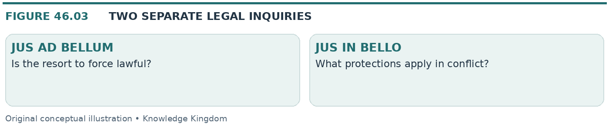

The Latin expression jus ad bellum refers to the legal rules on resorting to force. Jus in bello, commonly called international humanitarian law (IHL), concerns the rules applicable during armed conflict. International human rights law and international criminal law may also apply, but they ask additional questions. A single event can therefore generate several separate legal proceedings. \[<a href="/046-international-law-and-armed-conflict/sources/#source-4" class="cite">4</a>\]\[<a href="/046-international-law-and-armed-conflict/sources/#source-8" class="cite">8</a>\]

Suppose State A unlawfully invades State B. State B has a right to defend itself subject to the applicable requirements. Its forces nevertheless remain bound by humanitarian protections. A captured member of State A's army may not be tortured simply because A began the war. Equally, a soldier of the invading state who treats detainees humanely does not make the invasion lawful. Individual conduct and the interstate decision to use force must be evaluated separately.

This separation is sometimes described as the equality of belligerents under humanitarian law. It is not a declaration that both political causes are equally just. Nor does it imply that violations are equally numerous or serious on every side. It means that legal safeguards are not distributed according to political sympathy. When reading a news story, ask which question is actually being addressed. Is the commentator judging the origin of the conflict, an incident during it, the responsibility of a state, or the guilt of an individual? Arguments become clearer once their categories are identified.

<figure class="figure" id="figure-46-3">

<figcaption>Figure 46.3. The humanitarian obligations do not depend on the political justice of a cause. <a class="figure-anchor" href="#figure-46-3" aria-label="Link to this figure">#</a></figcaption>
</figure>
