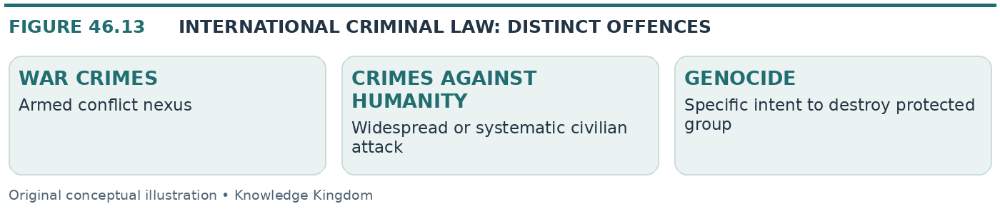

A war crime is not simply any immoral act committed while a war happens to be underway. International criminal law requires the elements of a recognized offense, including the relevant connection to an armed conflict where required. Crimes against humanity, under the Rome Statute, involve specified acts committed as part of a widespread or systematic attack directed against a civilian population, with the requisite knowledge. They need not occur during an armed conflict. The contextual requirements differ from those of war crimes. \[<a href="/046-international-law-and-armed-conflict/sources/#source-20" class="cite">20</a>\]\[<a href="/046-international-law-and-armed-conflict/sources/#source-43" class="cite">43</a>\]

Genocide has a particular legal definition under the 1948 Genocide Convention. It concerns specified acts committed with intent to destroy, in whole or in part, a protected national, ethnical, racial or religious group as such. Proving this special intent is a distinctive and often demanding legal inquiry. The gravity of an atrocity does not depend on whether it is ultimately classified as genocide. Crimes against humanity and war crimes can be extraordinarily grave. \[<a href="/046-international-law-and-armed-conflict/sources/#source-44" class="cite">44</a>\]

The term ethnic cleansing generally describes the forcible removal of a population from an area on ethnic or similar grounds. It is not a separate standalone offense in the Rome Statute, though acts described by the term may satisfy elements of recognized crimes. These distinctions are not an attempt to rank victims' suffering. They matter because criminal justice must give fair notice of the charge, prove the required elements and identify the applicable jurisdiction. Using the most emotionally powerful term for every atrocity can obscure the evidence needed to establish responsibility.

<figure class="figure" id="figure-46-13">

<figcaption>Figure 46.13. Different legal elements; overlapping conduct is possible. <a class="figure-anchor" href="#figure-46-13" aria-label="Link to this figure">#</a></figcaption>
</figure>
