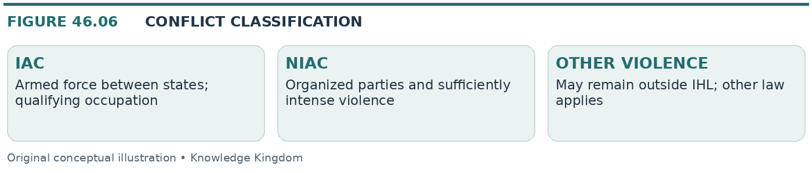

Humanitarian law applies when the facts meet the threshold of an armed conflict. It does not depend on a declaration of war, a government's preferred terminology, or the formal recognition of an adversary. In general, armed force between states triggers an international armed conflict (IAC); the law also applies to occupation covered by the Conventions even in the absence of fighting. \[<a href="/046-international-law-and-armed-conflict/sources/#source-2" class="cite">2</a>\]\[<a href="/046-international-law-and-armed-conflict/sources/#source-22" class="cite">22</a>\]

A non-international armed conflict (NIAC) generally involves sufficiently intense violence and sufficiently organized parties, which may be state forces and organized armed groups or opposing organized groups. An isolated act of violence or ordinary public disorder need not amount to such a conflict. Additional Protocol II has a more demanding specific treaty threshold, including requirements concerning the organized armed group's control of territory and ability to carry out sustained operations. Not every NIAC is covered by that Protocol. \[<a href="/046-international-law-and-armed-conflict/sources/#source-13" class="cite">13</a>\]\[<a href="/046-international-law-and-armed-conflict/sources/#source-22" class="cite">22</a>\]

Why does this distinction matter? The applicable treaty details, detention regimes and legal status of fighters may differ, even though basic humanitarian safeguards apply in both. Several conflicts of different legal types can coexist in one geographical region, especially when foreign states become involved. Analysts should not assume that a single political label settles every relationship. The ICTY's 1995 Tadić jurisdiction decision helped articulate the modern approach to classification and the reach of humanitarian law. \[<a href="/046-international-law-and-armed-conflict/sources/#source-23" class="cite">23</a>\]

<figure class="figure" id="figure-46-6">

<figcaption>Figure 46.6. Classification depends on facts rather than the label used by governments. <a class="figure-anchor" href="#figure-46-6" aria-label="Link to this figure">#</a></figcaption>
</figure>
