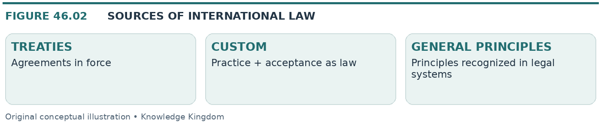

Article 38 of the Statute of the International Court of Justice is a useful starting point for the traditional sources of international law. Treaties are agreements governed by international law. Customary law arises from a sufficiently general practice accepted as legally required or permitted. General principles recognized across legal systems can help supply legal reasoning. Judicial decisions and the work of qualified scholars serve as subsidiary means of determining rules, rather than automatically legislating for every state. \[<a href="/046-international-law-and-armed-conflict/sources/#source-3" class="cite">3</a>\]\[<a href="/046-international-law-and-armed-conflict/sources/#source-5" class="cite">5</a>\]

A treaty may bind its parties but not a non-party simply because its text exists. A corresponding customary rule may, independently, apply more broadly. In Chapter 4 we learned that an archive does not interpret itself. The same is true of a diplomatic archive: a lawyer must examine wording, ratifications, reservations, practice and the question under dispute. A signature, ratification and entry into force are not necessarily the same event.

Custom is especially easy to misunderstand. If many states do something out of convenience, repetition alone does not establish that they believe the practice legally obligatory. The International Law Commission's 2018 conclusions distinguish practice from acceptance as law, often called opinio juris. Conversely, a state which denies that it committed a prohibited act may implicitly affirm the rule it is accused of breaching. Establishing custom requires examining a wider body of evidence, not merely counting examples favorable to a preferred argument. \[<a href="/046-international-law-and-armed-conflict/sources/#source-5" class="cite">5</a>\]\[<a href="/046-international-law-and-armed-conflict/sources/#source-6" class="cite">6</a>\]

<figure class="figure" id="figure-46-2">

<figcaption>Figure 46.2. Article 38 also identifies subsidiary means of determining rules. <a class="figure-anchor" href="#figure-46-2" aria-label="Link to this figure">#</a></figcaption>
</figure>
