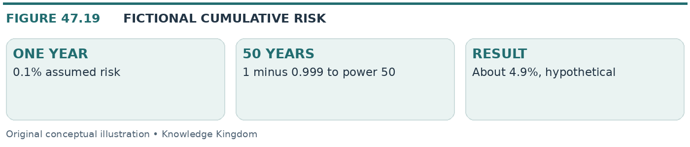

Suppose a fictional institution has a one-in-one-thousand chance of a severe failure in each year, under an artificial assumption that the probability stays constant and the events in different years are independent. This is a classroom probability example, not an estimate of nuclear war. Under these assumptions, the probability of avoiding failure in one year is 0.999. The probability of avoiding it for fifty years is 0.999 raised to the fiftieth power, approximately 0.951. The chance of at least one failure is therefore about 4.9 percent.

The exercise illustrates why a small annual probability need not remain small over a long period. But the assumptions are critical. Historical crises are not necessarily independent, political institutions change, and the annual probability of a catastrophic event is not something we can establish by looking only at the number of years without one. A prolonged period of peace could provide evidence about some aspects of a system's behavior without establishing an accurate probability of future failure.

For a second illustration, suppose the initial probability were uncertain and one analyst chose a value ten times as large as another. The long-term estimates would differ greatly, even if both analysts used the same arithmetic correctly. Numerical sophistication cannot compensate for unsupported inputs. This returns us to Chapter 3: a mathematical calculation can be exact relative to its assumptions while its relevance to the world remains uncertain. In nuclear risk debates, the absence of a precise probability should not be confused with the absence of a serious danger. Nor should a fictional probability be presented as an empirical forecast.

<figure class="figure" id="figure-47-19">

<figcaption>Figure 47.19. Illustrative independent-event arithmetic, not a nuclear-war forecast. <a class="figure-anchor" href="#figure-47-19" aria-label="Link to this figure">#</a></figcaption>
</figure>
