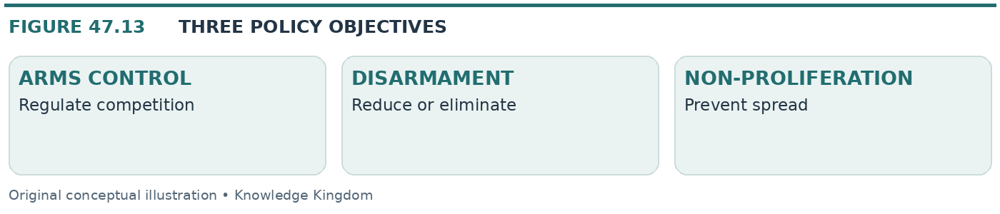

Arms control concerns agreed restrictions or other measures intended to regulate military competition and reduce danger. Disarmament concerns the reduction or elimination of weapons and associated capabilities. Non-proliferation concerns preventing their spread. The concepts overlap, but an agreement can pursue one goal without achieving the others. A treaty that prohibits a category of tests may improve international security without requiring the elimination of existing arsenals. A reduction in inventories may occur while the international relationship remains tense.

These distinctions explain why governments with very different long-term visions can sometimes cooperate. A state committed to retaining nuclear weapons for the foreseeable future may nevertheless accept restrictions intended to reduce uncertainty or prevent an uncontrolled arms race. A government seeking abolition may support intermediate agreements because they reduce danger while broader negotiations continue. The existence of partial agreement does not necessarily mean that the participants share the same ultimate objective.

Critics of arms control sometimes argue that negotiated restrictions can legitimize or entrench the weapons whose existence they oppose. Defenders respond that reducing immediate danger has independent value and that incremental measures can create conditions for deeper cooperation. This is a genuine policy disagreement rather than a simple dispute over definitions. It is important to distinguish whether an agreement is effective at its stated objective, whether that objective is sufficiently ambitious, and whether the agreement affects the prospects of future disarmament. A treaty may be valuable in one dimension and disappointing in another. \[<a href="/047-deterrence-and-nuclear-strategy/sources/#source-25" class="cite">25</a>\]\[<a href="/047-deterrence-and-nuclear-strategy/sources/#source-32" class="cite">32</a>\]\[<a href="/047-deterrence-and-nuclear-strategy/sources/#source-42" class="cite">42</a>\]

<figure class="figure" id="figure-47-13">

<figcaption>Figure 47.13. An agreement may contribute to more than one objective. <a class="figure-anchor" href="#figure-47-13" aria-label="Link to this figure">#</a></figcaption>
</figure>
