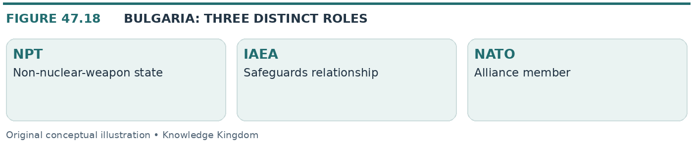

Bulgaria is a useful case because nuclear policy is not confined to countries that possess nuclear weapons. The country participates in international non-proliferation arrangements as a non-nuclear-weapon state under the NPT, has civilian nuclear energy institutions, and has been a member of NATO since 2004 and the European Union since 2007. These relationships concern different legal and political responsibilities. They should not be collapsed into a single claim about nuclear status.

Bulgaria's safeguards relationship with the International Atomic Energy Agency is part of the international framework governing peaceful nuclear activities. The country's electricity production and the regulation of nuclear safety involve distinct questions about engineering, economics, public administration and environmental responsibility. A person discussing Bulgarian nuclear energy should be able to distinguish the civilian role of a power station from the political role of nuclear deterrence within an alliance. The presence of civilian nuclear technology is not evidence that a country possesses nuclear weapons.

As a NATO member, Bulgaria participates in collective security decisions and consultations under the alliance's institutional framework. That does not make it an independent nuclear-weapon state, nor does the North Atlantic Treaty prescribe an automatic nuclear response to every crisis. Bulgarian citizens have legitimate interests in the country's energy policy, treaty obligations, diplomatic commitments and the broader humanitarian consequences of nuclear risk. A complete discussion of national security includes public accountability and informed democratic debate, rather than treating these questions as the exclusive concern of major powers. \[<a href="/047-deterrence-and-nuclear-strategy/sources/#source-19" class="cite">19</a>\]\[<a href="/047-deterrence-and-nuclear-strategy/sources/#source-20" class="cite">20</a>\]\[<a href="/047-deterrence-and-nuclear-strategy/sources/#source-32" class="cite">32</a>\]\[<a href="/047-deterrence-and-nuclear-strategy/sources/#source-58" class="cite">58</a>\]\[<a href="/047-deterrence-and-nuclear-strategy/sources/#source-63" class="cite">63</a>\]\[<a href="/047-deterrence-and-nuclear-strategy/sources/#source-64" class="cite">64</a>\]

<figure class="figure" id="figure-47-18">

<figcaption>Figure 47.18. Civilian nuclear energy and alliance membership are distinct from possession. <a class="figure-anchor" href="#figure-47-18" aria-label="Link to this figure">#</a></figcaption>
</figure>
