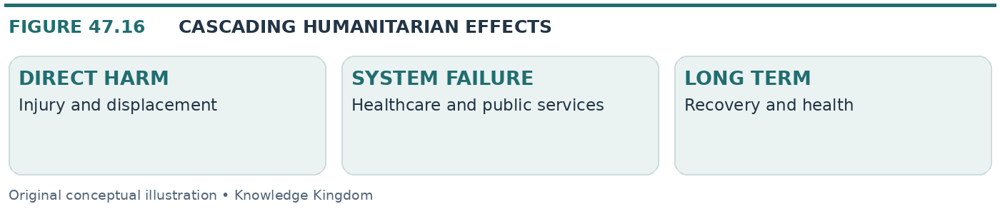

The humanitarian consequences of nuclear weapon use are not limited to immediate physical injury. The International Committee of the Red Cross emphasizes the extraordinary difficulty of providing adequate assistance after a nuclear detonation in or near a populated area. Healthcare systems, transport, communications and essential public services may themselves be damaged precisely when the demand for assistance becomes greatest. People who survive the initial disaster can face a prolonged struggle for medical care, shelter, clean water and the restoration of ordinary life.

Radiation-related health effects require careful scientific interpretation. Risks depend on exposure and individual circumstances, and not every illness in an affected population can automatically be attributed to radiation. Conversely, an absence of an immediate symptom does not establish an absence of long-term risk. Epidemiological research, reliable exposure records and long-term follow-up are therefore important. The purpose of recognizing uncertainty is to improve the quality of public health judgments, not to diminish the experiences of people who have suffered.

There is a deeper institutional problem. Much of ordinary emergency preparedness assumes that help can arrive from functioning neighboring communities or national institutions. A catastrophe that affects those institutions at the same time as the people needing help undermines that assumption. This is a systems problem of the kind described in Chapter 7: several essential networks can fail together, multiplying the effects of the original event. Humanitarian agencies accordingly emphasize prevention rather than suggesting that an adequate response can reliably be guaranteed. \[<a href="/047-deterrence-and-nuclear-strategy/sources/#source-1" class="cite">1</a>\]\[<a href="/047-deterrence-and-nuclear-strategy/sources/#source-2" class="cite">2</a>\]\[<a href="/047-deterrence-and-nuclear-strategy/sources/#source-52" class="cite">52</a>\]

<figure class="figure" id="figure-47-16">

<figcaption>Figure 47.16. Multiple social systems can be affected together. <a class="figure-anchor" href="#figure-47-16" aria-label="Link to this figure">#</a></figcaption>
</figure>
