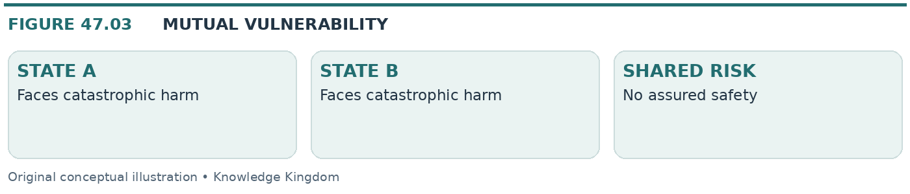

The term mutually assured destruction, usually shortened to MAD, describes a condition in which rival nuclear powers each face the prospect of devastating harm if nuclear war occurs between them. The political implication is that victory becomes extraordinarily difficult to define in any ordinary sense. A country whose society, institutions and economy have been devastated has little reason to celebrate an abstract military success. Mutual vulnerability therefore sits at the heart of many explanations of Cold War restraint.

MAD is often presented as though it were a treaty, an official universally accepted doctrine or a guarantee of peace. It is none of these things. Governments and scholars have disagreed about what mutual vulnerability means, how stable it is and whether reliance on it is morally defensible. Some national doctrines have emphasized different kinds of assurances or obligations, and their language has changed over time. The expression is best understood as an analytical shorthand for a relationship rather than a description of a uniform policy shared by all nuclear-armed states.

A useful distinction is between a proposition about incentives and a proposition about outcomes. One may argue that fear of devastation makes a deliberately initiated nuclear war less attractive. It does not follow that nuclear war is impossible. Errors, misunderstandings, accidents, domestic instability and decisions made under extraordinary pressure can interrupt the expected relationship between incentives and behavior. Moreover, a government may believe that a rival is more willing to accept risk than it actually is. A theoretical equilibrium is not a safety certificate. \[<a href="/047-deterrence-and-nuclear-strategy/sources/#source-3" class="cite">3</a>\]\[<a href="/047-deterrence-and-nuclear-strategy/sources/#source-12" class="cite">12</a>\]\[<a href="/047-deterrence-and-nuclear-strategy/sources/#source-13" class="cite">13</a>\]

Public doctrine also needs careful interpretation. First use means initiating nuclear use in a conflict, whereas a no-first-use pledge is a commitment not to be the first to do so. Retaliation is often discussed under the term second strike; the expression describes a response, not a lawful entitlement to inflict indiscriminate harm. China has publicly reaffirmed its no-first-use policy, and India has described its own policy in similar terms, although the wording and qualifications of national commitments can differ. Negative security assurances are promises relating to the non-use or non-threat of nuclear weapons against non-nuclear states. A national declaration, a bilateral arrangement and a binding international treaty have different legal force. The significance of any pledge must be considered through its exact terms, institutional context and credibility, not simply through its label. \[<a href="/047-deterrence-and-nuclear-strategy/sources/#source-60" class="cite">60</a>\]\[<a href="/047-deterrence-and-nuclear-strategy/sources/#source-61" class="cite">61</a>\]\[<a href="/047-deterrence-and-nuclear-strategy/sources/#source-62" class="cite">62</a>\]

<figure class="figure" id="figure-47-3">

<figcaption>Figure 47.3. Mutual vulnerability is not a guarantee of peace. <a class="figure-anchor" href="#figure-47-3" aria-label="Link to this figure">#</a></figcaption>
</figure>
