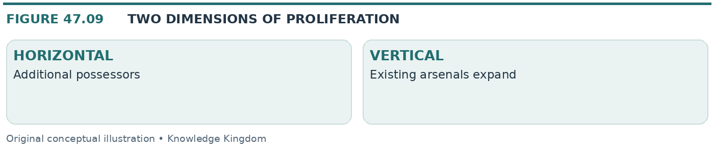

Proliferation refers to the spread of nuclear weapons to additional actors. Analysts sometimes distinguish horizontal proliferation, meaning acquisition by additional states, from vertical proliferation, referring broadly to expansion or development of arsenals by existing nuclear powers. The distinction clarifies which problem a particular political measure addresses. Preventing the appearance of an additional nuclear-armed state is not identical to reducing existing inventories.

States have pursued nuclear weapons for different reasons. Security against perceived threats is an important explanation, but it does not account for all variation. Domestic institutions, scientific communities, national status, leadership priorities and the symbolic meaning of technological achievement may influence decisions. Conversely, a state may possess the scientific expertise associated with advanced peaceful nuclear activities without choosing to acquire nuclear weapons. Political intention cannot be inferred simply from a country's level of technological development.

Scott Sagan's influential analysis of proliferation identifies security, domestic political interests and norms as different explanatory models. A particularly useful question is why states with apparently comparable external threats sometimes make different choices. One might seek a reliable alliance, another might emphasize legal neutrality, and another might pursue independent capabilities. A historical explanation should examine the particular decision-making institutions and international relationships rather than assume that all governments value the same things. Likewise, reducing proliferation risk is not only a technical problem; it involves security arrangements, trustworthy international institutions and the legitimacy of the global rules themselves. \[<a href="/047-deterrence-and-nuclear-strategy/sources/#source-9" class="cite">9</a>\]\[<a href="/047-deterrence-and-nuclear-strategy/sources/#source-30" class="cite">30</a>\]\[<a href="/047-deterrence-and-nuclear-strategy/sources/#source-31" class="cite">31</a>\]

<figure class="figure" id="figure-47-9">

<figcaption>Figure 47.9. Different aspects of the proliferation problem. <a class="figure-anchor" href="#figure-47-9" aria-label="Link to this figure">#</a></figcaption>
</figure>
