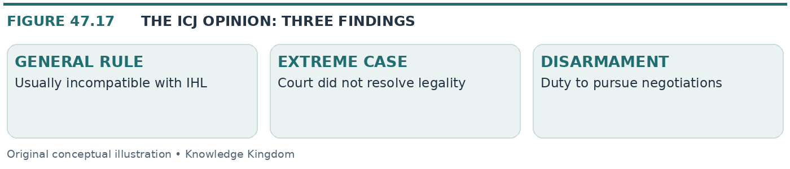

Chapter 46 distinguished the law governing the resort to force from humanitarian law governing conduct during armed conflict. Both bodies of law are relevant to nuclear weapons. In 1996, the International Court of Justice delivered an advisory opinion on the legality of their threat or use, responding to a question from the United Nations General Assembly. The opinion is an important legal document, but it is often summarized more categorically than its actual conclusions warrant.

The Court found that the threat or use of nuclear weapons would generally be contrary to the rules of international law applicable in armed conflict, particularly humanitarian law. It also stated that it could not conclude definitively whether such threat or use would be lawful or unlawful in an extreme circumstance of self-defence in which the survival of a state would be at stake. This was an unresolved conclusion in the opinion, not an affirmative authorization for nuclear use in that circumstance. The Court separately affirmed an obligation to pursue in good faith and bring to a conclusion negotiations leading to nuclear disarmament under effective international control.

An advisory opinion is different from a criminal judgment or a treaty creating new contractual commitments. Its legal reasoning carries authority, but it must be read with its precise language, the question posed and the subsequent development of international law in mind. The 2017 prohibition treaty creates further specific obligations for its parties. A country's invocation of self-defence does not erase the applicable requirements of humanitarian law, and the legal treatment of a threat cannot be established simply by calling it deterrence. \[<a href="/047-deterrence-and-nuclear-strategy/sources/#source-54" class="cite">54</a>\]\[<a href="/047-deterrence-and-nuclear-strategy/sources/#source-55" class="cite">55</a>\]

<figure class="figure" id="figure-47-17">

<figcaption>Figure 47.17. The unresolved question is not an authorization. <a class="figure-anchor" href="#figure-47-17" aria-label="Link to this figure">#</a></figcaption>
</figure>
