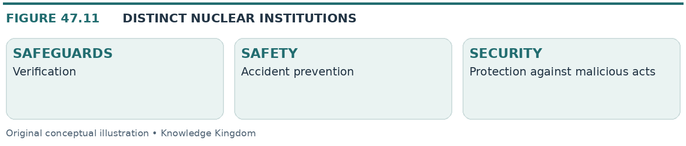

Nuclear science has uses beyond weapons. Electricity generation, medical diagnosis and treatment, research, industrial applications and agricultural science all make use of knowledge related to atomic processes. An international system concerned with non-proliferation therefore faces a difficult task: it must distinguish prohibited military acquisition from legitimate peaceful cooperation without treating all nuclear activity as presumptively unlawful.

The International Atomic Energy Agency, founded in 1957, performs a central role in international verification under safeguards agreements. Safeguards are arrangements designed to help establish whether states are complying with relevant commitments concerning nuclear material and activities. The legal authority available to the agency depends on the applicable agreements and other mandates. Its findings should be understood in relation to that authority and the evidence actually available to its inspectors and analysts.

Safeguards are not identical to nuclear safety or nuclear security. Safety concerns preventing accidents and protecting people and the environment from radiation hazards. Security concerns protection against malicious acts and unauthorized access. Safeguards concern verification of specified non-proliferation obligations. These activities can be related, but each has a different institutional purpose. A power station may satisfy a safeguards obligation while facing a separate question about its engineering safety, and a safety incident does not by itself establish a weapons program. Distinguishing the categories is essential when reading public discussion of nuclear facilities. The broader lesson is that trustworthy verification supports peaceful cooperation rather than necessarily obstructing it. \[<a href="/047-deterrence-and-nuclear-strategy/sources/#source-33" class="cite">33</a>\]\[<a href="/047-deterrence-and-nuclear-strategy/sources/#source-34" class="cite">34</a>\]

<figure class="figure" id="figure-47-11">

<figcaption>Figure 47.11. The three functions are related but not synonymous. <a class="figure-anchor" href="#figure-47-11" aria-label="Link to this figure">#</a></figcaption>
</figure>
