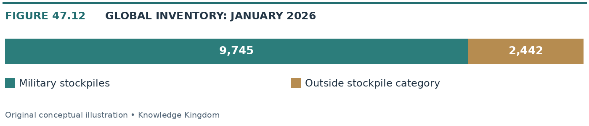

The Stockholm International Peace Research Institute estimated that nine states possessed approximately 12,187 nuclear weapons in January 2026. Of these, about 9,745 were in military stockpiles for potential use. The remainder were outside that category, including retired weapons awaiting dismantlement. These are aggregate estimates, not an exact census. Their date matters: a figure for January should not be described as a live count for November. \[<a href="/047-deterrence-and-nuclear-strategy/sources/#source-40" class="cite">40</a>\]\[<a href="/047-deterrence-and-nuclear-strategy/sources/#source-41" class="cite">41</a>\]

The distinction between an inventory and a stockpile matters because different reports count different things. A headline may announce an increase in one category while a longer-term aggregate declines because retired weapons are being dismantled. Another report may focus on weapons covered by a particular agreement rather than the total inventory. The figures can all be compatible if their categories and dates differ. The reader should first ask what is included and what is excluded, then consider what comparison is appropriate.

Here is a simple arithmetic example using those published estimates. Subtracting 9,745 from 12,187 gives approximately 2,442 weapons outside the military-stockpile category, or roughly one-fifth of the estimated total. This does not mean that every weapon in the remainder is identical in status, nor does the calculation make the underlying estimates more precise. It illustrates how a useful number can be obtained from uncertain data while preserving the original uncertainty. Counts are evidence about the scale of the problem, not a complete measure of danger, political intention or humanitarian consequences. The concentration of global destructive capacity remains a concern even when numerical categories are difficult to compare.

<figure class="figure" id="figure-47-12">

<figcaption>Figure 47.12. SIPRI estimates: 9,745 in military stockpiles; 2,442 outside that category; total 12,187 \[40\]. <a class="figure-anchor" href="#figure-47-12" aria-label="Link to this figure">#</a></figcaption>
</figure>
