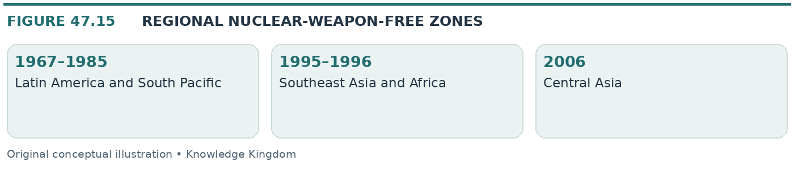

It is easy to regard the international nuclear order as something designed exclusively in Washington, Moscow, London, Paris or Beijing. The history of nuclear-weapon-free zones challenges that view. Groups of states have negotiated regional treaties restricting nuclear weapons in their own territories and creating institutions or procedures to support their commitments. These agreements give regional actors a way to define aspects of their own security rather than simply accept arrangements designed by distant powers.

The Treaty of Tlatelolco was opened for signature in 1967 and established a nuclear-weapon-free zone in Latin America and the Caribbean. Subsequent agreements include the Treaty of Rarotonga for the South Pacific, the Treaty of Bangkok for Southeast Asia, the Treaty of Pelindaba for Africa and the treaty establishing a Central Asian nuclear-weapon-free zone, signed at Semipalatinsk in 2006. Their provisions and geographical definitions differ. Some contain protocols through which nuclear-weapon states can undertake additional obligations toward the region. The protocols themselves may involve qualifications, reservations or disagreements about interpretation.

The achievement of these agreements lies partly in their regional origin. A shared norm of restraint can help states establish expectations about their neighbors' conduct without requiring them to eliminate every other disagreement. At the same time, a regional treaty cannot remove the worldwide consequences of nuclear conflict elsewhere. The zones therefore operate alongside global non-proliferation and disarmament efforts. Their history provides an important reminder that smaller states and non-nuclear states are participants in the construction of international law, not merely recipients of decisions made by nuclear powers. \[<a href="/047-deterrence-and-nuclear-strategy/sources/#source-48" class="cite">48</a>\]\[<a href="/047-deterrence-and-nuclear-strategy/sources/#source-49" class="cite">49</a>\]

<figure class="figure" id="figure-47-15">

<figcaption>Figure 47.15. Selected treaty signature milestones. <a class="figure-anchor" href="#figure-47-15" aria-label="Link to this figure">#</a></figcaption>
</figure>
