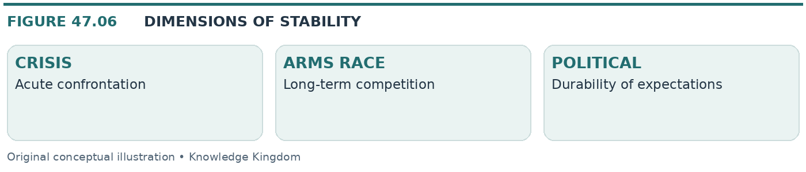

Strategic stability is a broad term for conditions in which major-power military competition is less likely to lead to catastrophic conflict. Analysts use it in different ways. Crisis stability concerns the danger that acute confrontations may become uncontrollable. Arms-race stability concerns the tendency for military competition to generate continuing pressure for expansion. Political stability includes the durability of arrangements, communication and expectations over time. These dimensions can overlap without moving together.

Consider a hypothetical international relationship in which two governments have agreed not to alter an existing boundary and have established a reliable mechanism for discussing incidents. Their diplomatic relationship may become more predictable while their competition in technology intensifies. A commentator who speaks of 'stability' should identify the dimension being discussed. Likewise, an arms-control agreement may improve transparency without resolving the territorial conflict that made both governments suspicious in the first place.

A common error is to regard stability as a property of a numerical balance alone. Institutions, alliances, domestic politics, perceptions of legitimacy and diplomatic contact all matter. Even the description of stability can be contested: a status quo that major powers find comfortable may be unacceptable to the citizens of a smaller state whose independence is compromised. We should not use the absence of a great-power confrontation as a moral endorsement of every surrounding political arrangement. The appropriate question is which risks are being reduced, by what institutional means, and for whom. \[<a href="/047-deterrence-and-nuclear-strategy/sources/#source-12" class="cite">12</a>\]\[<a href="/047-deterrence-and-nuclear-strategy/sources/#source-15" class="cite">15</a>\]\[<a href="/047-deterrence-and-nuclear-strategy/sources/#source-16" class="cite">16</a>\]

<figure class="figure" id="figure-47-6">

<figcaption>Figure 47.6. Stability has several dimensions. <a class="figure-anchor" href="#figure-47-6" aria-label="Link to this figure">#</a></figcaption>
</figure>
