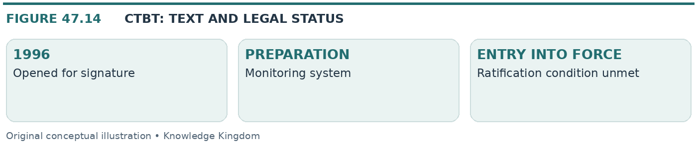

The Comprehensive Nuclear-Test-Ban Treaty, opened for signature in 1996, prohibits nuclear weapon test explosions and other nuclear explosions. Its scope is broader than that of the 1963 treaty. Yet its entry into force is subject to a special requirement: ratification by the states named in Annex 2, followed by the prescribed waiting period. As of the editorial research date in November 2026, the treaty had not entered into force. This distinction between an agreed text and a legally effective treaty is fundamental to international law.

The Preparatory Commission for the Comprehensive Nuclear-Test-Ban Treaty Organization has developed an international verification system in anticipation of entry into force. Its monitoring and analysis activities support awareness of relevant events. Some formal treaty powers, such as the treaty's on-site inspection mechanism, depend on entry into force. It is therefore inaccurate either to describe the treaty as fully operational in every legal respect or to dismiss the existing institution as meaningless because the treaty has not entered into force.

The CTBT demonstrates that international cooperation can produce partial practical benefits before all legal conditions are satisfied. It also shows how an agreement's institutional design can become a barrier to its full effectiveness. A demanding entry-into-force rule may have been intended to ensure participation by particularly important states, but it also means that a small number of outstanding ratifications can delay the treaty indefinitely. This is a useful example of the tension between inclusive participation and institutional flexibility that appears throughout international politics. \[<a href="/047-deterrence-and-nuclear-strategy/sources/#source-45" class="cite">45</a>\]\[<a href="/047-deterrence-and-nuclear-strategy/sources/#source-46" class="cite">46</a>\]\[<a href="/047-deterrence-and-nuclear-strategy/sources/#source-47" class="cite">47</a>\]

<figure class="figure" id="figure-47-14">

<figcaption>Figure 47.14. Status as of November 2026. <a class="figure-anchor" href="#figure-47-14" aria-label="Link to this figure">#</a></figcaption>
</figure>
