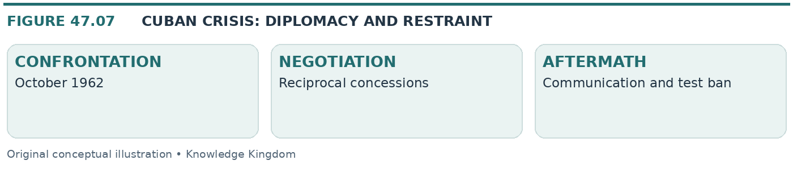

In October 1962, a confrontation involving the United States, Soviet Union and Cuba brought the danger of nuclear war into sharp focus. The crisis arose from a combination of Cold War rivalry, Soviet actions in Cuba, American security concerns and the island's experience of hostility from the United States. Cuba was an independent political actor, not simply a square on a superpower chessboard. Its government had its own reasons to fear intervention, particularly after the failed Bay of Pigs invasion in 1961.

The crisis was resolved through diplomatic exchanges and concessions. The Soviet Union agreed to remove the weapons at issue from Cuba; the United States publicly undertook not to invade the island and privately agreed to remove American missiles from Türkiye. The public and private dimensions of the settlement illustrate that a diplomatic outcome may be understood differently by domestic audiences and by the parties who negotiated it. A simplistic narrative in which one leader displayed resolve and the other simply surrendered obscures the compromises that helped end the crisis.

The experience contributed to a more serious examination of communication and arms control, including the establishment of a direct communications link between Washington and Moscow in 1963 and the Limited Test Ban Treaty of the same year. One cannot infer from the peaceful outcome that the preceding danger was necessary or desirable. We know that the parties reached a settlement; we do not know that every alternative course would have produced war. The episode shows both the potential importance of restraint and the limits of confident retrospective storytelling. \[<a href="/047-deterrence-and-nuclear-strategy/sources/#source-22" class="cite">22</a>\]\[<a href="/047-deterrence-and-nuclear-strategy/sources/#source-23" class="cite">23</a>\]

<figure class="figure" id="figure-47-7">

<figcaption>Figure 47.7. Selected political milestones, not an operational account. <a class="figure-anchor" href="#figure-47-7" aria-label="Link to this figure">#</a></figcaption>
</figure>
