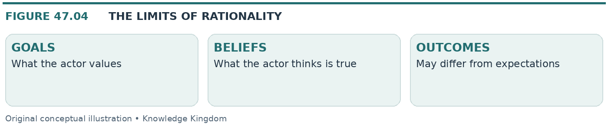

A rational actor, in the modest sense used by many social scientists, makes choices that are consistent with its goals and beliefs. This does not imply that the actor knows everything, possesses accurate beliefs, has admirable goals or calculates without error. A person who takes the wrong road because a trusted map contains a mistake may have acted reasonably on false information. International leaders encounter similar problems on a far larger scale.

Deterrence theory often simplifies government decisions by treating states as actors. This is a legitimate analytical convenience when the question concerns international incentives. It becomes misleading if we forget that a state includes competing officials, bureaucracies, intelligence organizations, military institutions and political leaders. They may disagree about what information is reliable and what the country's interests require. No human institution sees the international system as a complete and transparent picture.

Theories of deterrence are strongest when their assumptions are made explicit. Rationality, sufficiently shared interpretations of consequences, organizational control and political continuity are different assumptions. A country might value survival and nevertheless misinterpret a rival's intentions. It might understand the danger but possess poorly coordinated institutions. It might have an accurate assessment in one crisis and an inaccurate assessment in the next. The question is not whether leaders are always rational or always irrational, but which conditions make reasonable judgment more or less likely. This is a direct application of the lessons from Chapters 1 and 7: models illuminate systems when we remember the processes they leave out. \[<a href="/047-deterrence-and-nuclear-strategy/sources/#source-12" class="cite">12</a>\]\[<a href="/047-deterrence-and-nuclear-strategy/sources/#source-14" class="cite">14</a>\]

<figure class="figure" id="figure-47-4">

<figcaption>Figure 47.4. Rational choice does not imply perfect knowledge. <a class="figure-anchor" href="#figure-47-4" aria-label="Link to this figure">#</a></figcaption>
</figure>
