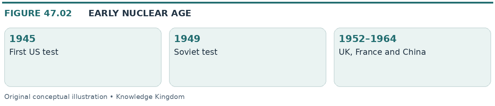

The United States was the only state possessing nuclear weapons at the end of the Second World War. For a brief period, some observers entertained hopes that this monopoly would provide permanent strategic superiority or permit an internationally supervised atomic order. The Soviet Union's first nuclear test in 1949 ended the monopoly. Britain followed in 1952, France in 1960 and China in 1964. These dates mark changes in the distribution of power, not a single uniform path by which states came to make their decisions.

The development of these arsenals was connected to national prestige, alliance politics, the experience of war and the perception of vulnerability. British and French decisions, for example, cannot be understood simply as responses to the number of weapons another country held. Governments also worried about independence in foreign policy, their position among major powers and the reliability of allies. China confronted a different historical setting, shaped by revolution, foreign intervention, the Korean War and deteriorating relations with the Soviet Union. Security concerns interacted with political identity.

At the same time, there were early efforts to control the new danger internationally. The United Nations General Assembly's first resolution in January 1946 established a commission to address atomic energy. The idea of international regulation therefore predates the later superpower arms-control system. Its difficulties were not merely scientific. Governments disagreed about the distribution of authority, the credibility of inspection and the relationship between existing arsenals and future obligations. The problem of trust, which we encountered in Chapter 45, was now inseparable from a technology that could have global consequences. \[<a href="/047-deterrence-and-nuclear-strategy/sources/#source-6" class="cite">6</a>\]\[<a href="/047-deterrence-and-nuclear-strategy/sources/#source-8" class="cite">8</a>\]\[<a href="/047-deterrence-and-nuclear-strategy/sources/#source-9" class="cite">9</a>\]

<figure class="figure" id="figure-47-2">

<figcaption>Figure 47.2. Selected historical milestones in the early nuclear age. <a class="figure-anchor" href="#figure-47-2" aria-label="Link to this figure">#</a></figcaption>
</figure>
