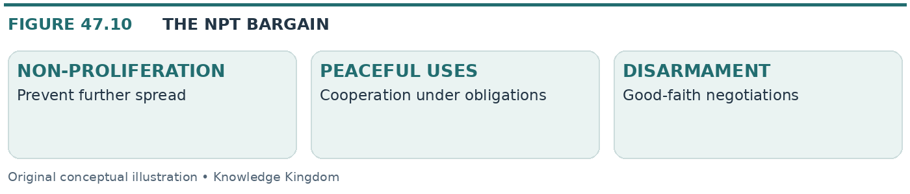

The Treaty on the Non-Proliferation of Nuclear Weapons was opened for signature in 1968 and entered into force in 1970. In 1995 its parties agreed to extend it indefinitely. The treaty is often described through three related pillars: preventing the spread of nuclear weapons, cooperation in peaceful uses of nuclear energy, and nuclear disarmament. All three are needed to understand the bargain. Presenting the treaty as a prohibition on acquisition alone gives an incomplete picture of the obligations accepted by its members.

The treaty distinguishes nuclear-weapon states as defined by its own historical criterion from non-nuclear-weapon states parties. The five recognized nuclear-weapon states under that definition are the United States, Russia as successor to the Soviet Union, the United Kingdom, France and China. This category is a treaty status, not a comprehensive list of every country possessing nuclear weapons. India, Pakistan and Israel never joined the NPT; North Korea announced its withdrawal in 2003. The treaty's recognition of an existing distinction does not amount to a perpetual moral entitlement to possession.

Article VI requires parties to pursue good-faith negotiations on effective measures concerning the cessation of the nuclear arms race and nuclear disarmament, alongside broader disarmament objectives. For many non-nuclear states, this commitment is central to the fairness and legitimacy of the regime. For nuclear-armed parties, the relationship between disarmament obligations and international security conditions remains a major policy debate. The NPT is consequently both a legal instrument and a political bargain whose durability depends partly on how its members understand the performance of obligations by others. \[<a href="/047-deterrence-and-nuclear-strategy/sources/#source-9" class="cite">9</a>\]\[<a href="/047-deterrence-and-nuclear-strategy/sources/#source-31" class="cite">31</a>\]\[<a href="/047-deterrence-and-nuclear-strategy/sources/#source-32" class="cite">32</a>\]

<figure class="figure" id="figure-47-10">

<figcaption>Figure 47.10. The three pillars are interconnected. <a class="figure-anchor" href="#figure-47-10" aria-label="Link to this figure">#</a></figcaption>
</figure>
