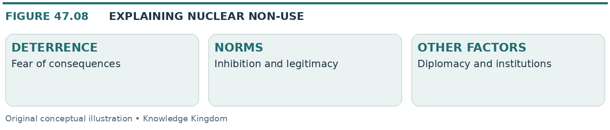

Since the bombings of Hiroshima and Nagasaki in 1945, nuclear weapons have not been used in war. A major question for international-relations scholarship is why. Deterrence offers one answer: leaders feared the consequences of use, including retaliation or escalation. But some wars involved nuclear-armed states and adversaries without nuclear weapons of their own. Why did governments sometimes refrain even in such circumstances?

Nina Tannenwald argues that a normative prohibition on nuclear use developed over the decades following 1945. Norms are shared expectations about appropriate behavior, not necessarily formal legal rules. A government may consider an action unacceptable partly because of the political and moral meaning attached to it, independently of its direct military consequences. The growth of antinuclear movements, diplomatic condemnation and public awareness of humanitarian harm helped shape the political environment in which decisions were made.

Not all scholars accept the same strength or scope for the nuclear taboo. Some distinguish a tradition of non-use from a deep moral prohibition. Survey experiments have also suggested that public opposition can depend strongly on circumstances. The evidence does not justify assuming that a norm will always survive pressure. A norm can be influential without being absolute. Deterrence and norms can also operate together: a decision may reflect fear of military consequences, legal concerns, expectations of international condemnation and personal moral judgment simultaneously. A serious explanation must account for the interaction of those factors instead of forcing history to choose a single cause. \[<a href="/047-deterrence-and-nuclear-strategy/sources/#source-26" class="cite">26</a>\]\[<a href="/047-deterrence-and-nuclear-strategy/sources/#source-27" class="cite">27</a>\]\[<a href="/047-deterrence-and-nuclear-strategy/sources/#source-28" class="cite">28</a>\]

<figure class="figure" id="figure-47-8">

<figcaption>Figure 47.8. Several explanations can operate together. <a class="figure-anchor" href="#figure-47-8" aria-label="Link to this figure">#</a></figcaption>
</figure>
