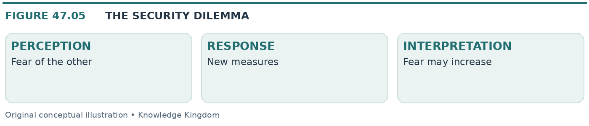

In Chapter 45 we examined the security dilemma: actions intended to increase one country's security may decrease another country's sense of security. Nuclear politics intensifies this difficulty. A government may describe an expensive military program as necessary for national protection, while a rival regards it as evidence of hostile intentions. The second government responds, the first feels vindicated and mutual suspicion deepens. Each side may tell a convincing story in which it was merely reacting to the other.

The model does not imply that every international dispute is an innocent misunderstanding. Some states knowingly seek territorial conquest or attempt to intimidate others; aggression is not erased by the vocabulary of insecurity. The security dilemma is useful because it identifies one mechanism by which fear can become self-reinforcing, including in relationships where leaders have mixed motives. A careful analysis must examine the evidence for different interpretations rather than assume that all parties have equal responsibility.

The distinction between intent and observable capability is central. A country's leaders may announce benign purposes, but others cannot simply observe private intentions or guarantee that future governments will share them. At the same time, assuming the worst in every case can make accommodation impossible. Diplomacy, transparency and agreements can reduce uncertainty without requiring friendship. A world in which adversaries understand each other's obligations and communicate reliably is not the same as a world without conflict; it is a world in which some avoidable forms of conflict become less likely. \[<a href="/047-deterrence-and-nuclear-strategy/sources/#source-12" class="cite">12</a>\]\[<a href="/047-deterrence-and-nuclear-strategy/sources/#source-15" class="cite">15</a>\]

<figure class="figure" id="figure-47-5">

<figcaption>Figure 47.5. A self-reinforcing process; actual aggression requires separate assessment. <a class="figure-anchor" href="#figure-47-5" aria-label="Link to this figure">#</a></figcaption>
</figure>
