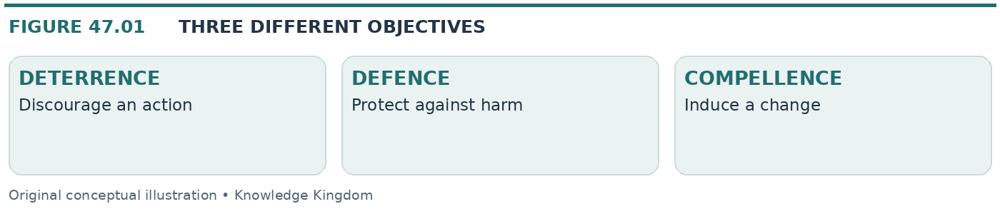

Deterrence is an attempt to persuade another actor not to undertake an action by changing its expectations about the consequences. A shopkeeper may install a security system hoping that theft will not occur. A government may impose sanctions to discourage a violation of an agreement. A collective defence treaty may discourage an attack by making the prospective aggressor anticipate opposition from more than one country. The underlying idea is behavioral rather than mechanical: a measure deters only if it influences another actor's choice.

It is useful to distinguish deterrence from defence. Defence seeks to protect people or territory when harm occurs; deterrence seeks to prevent a harmful decision in the first place. A single institution can contribute to both, but the concepts cannot be treated as synonyms. Nor is deterrence the same as diplomacy. Diplomacy is the broader practice of communicating and negotiating among political communities, and it may include reassurance, threats, promises and compromise. Deterrence can operate within that practice rather than replace it.

Thomas Schelling's work placed bargaining and expectations at the center of the study of conflict. The importance of his scholarship is not that every person calculates perfectly. It is that international politics involves decisions made in anticipation of other decisions. A policy whose intended recipient interprets it differently from the sender may have an effect opposite to the one desired. For this reason, it is useful to ask what decision was supposedly prevented, who was making it and what evidence exists of a changed expectation. A vague declaration that a country is 'deterred' is not a complete explanation. \[<a href="/047-deterrence-and-nuclear-strategy/sources/#source-3" class="cite">3</a>\]

<figure class="figure" id="figure-47-1">

<figcaption>Figure 47.1. These concepts identify different objectives, not a hierarchy of policies. <a class="figure-anchor" href="#figure-47-1" aria-label="Link to this figure">#</a></figcaption>
</figure>
