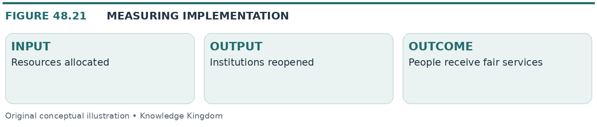

In Lydora, a political agreement promises the restoration of local courts, equal access to schools, the protection of displaced families and independent public-budget review. Two years later, government officials point to new buildings and claim that the agreement has succeeded. Civil society organizations say that many residents remain unable to use the institutions. How should an observer assess these apparently competing claims?

Begin by distinguishing inputs, outputs and outcomes. Funds allocated to a court are an input. Hiring clerks and reopening the court are outputs. Residents obtaining timely, fair and enforceable judgments are outcomes. An institution can achieve its output target while failing to deliver the intended public benefit. The same distinction applies to a school, a health clinic or a property-registration office. The buildings matter, but the public purpose is not the buildings themselves.

The commission might examine independent surveys, service records, complaint procedures, public spending and the experiences of different communities. It should report uncertainty and allow evidence from residents who may not be represented in official records. Where statistics and personal testimony seem inconsistent, it should investigate the reason rather than automatically dismiss one form of evidence. A survey may conceal regional inequality; an individual report may identify an important failure without establishing its prevalence. The purpose of verification is to make political promises answerable to observable public outcomes.

<figure class="figure" id="figure-48-21">

<figcaption>Figure 48.21. Outputs matter, but outcomes test whether the policy serves citizens. <a class="figure-anchor" href="#figure-48-21" aria-label="Link to this figure">#</a></figcaption>
</figure>
