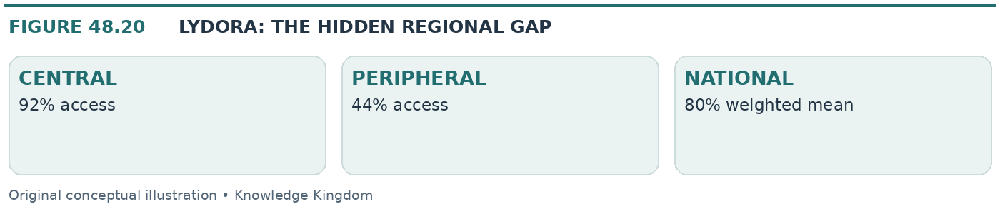

Return to the fictional state of Lydora. A survey reports that 80 percent of households nationally have access to a functioning primary healthcare facility. That sounds reassuring until we discover that 75 percent of households live in the central region, where access is 92 percent, and the remaining quarter live in a peripheral region, where access is only 44 percent.

Check the arithmetic. In a hypothetical population of 1,000 households, 750 live in the center. Ninety-two percent of 750 is 690. Of the 250 peripheral households, 44 percent, or 110, have access. Together 800 households have access, giving the reported national rate of 80 percent. The average is mathematically correct. It nevertheless hides a 48-percentage-point gap between the two regions.

The statistic does not establish why the gap exists. Perhaps the peripheral region is mountainous, has fewer roads or has suffered recent infrastructure damage. Perhaps government funding has been allocated unfairly. Several mechanisms may operate together. A careful investigation would examine spending, travel times, staffing, health outcomes, historical investment and the experience of households. It would also ask whether citizens can influence decisions and obtain remedies. A numerical disparity is a starting point for analysis, not a proof of discriminatory intention or a prediction of civil war.

<figure class="figure" id="figure-48-20">

<figcaption>Figure 48.20. Fictional data: regional disparity is 48 percentage points. <a class="figure-anchor" href="#figure-48-20" aria-label="Link to this figure">#</a></figcaption>
</figure>
