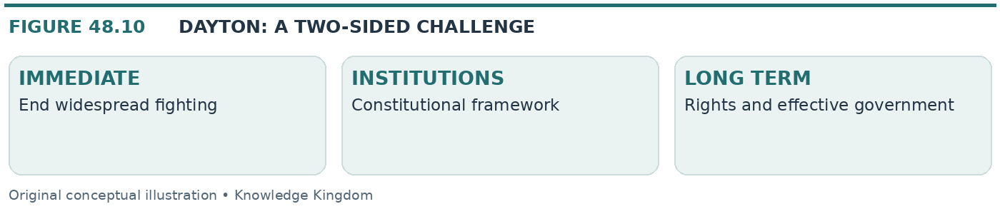

The breakup of socialist Yugoslavia involved competing claims about sovereignty, nationalism, political authority and territory. The 1992–1995 war in Bosnia and Herzegovina included systematic forced displacement, persecution and other atrocities. International courts subsequently established that genocide was committed at Srebrenica in July 1995. This is a judicial finding, not merely one political interpretation of the conflict. \[<a href="/048-civil-wars-and-fragile-states/sources/#source-28" class="cite">28</a>\]

The Dayton agreement, negotiated in November and signed in December 1995, ended the war and provided a constitutional framework for Bosnia and Herzegovina, including two entities and institutions at the state level. The settlement helped secure an end to widespread hostilities, but its arrangements also institutionalized certain political distinctions among constituent peoples. Later disputes have concerned the effectiveness and inclusiveness of those institutions. \[<a href="/048-civil-wars-and-fragile-states/sources/#source-29" class="cite">29</a>\]

This illustrates a difficult peacebuilding dilemma. A constitutional arrangement acceptable to opposing leaderships at the end of war may reduce immediate fears while making long-term political integration complicated. The appropriate comparison is not between an actual imperfect agreement and an imaginary ideal with no political constraints. It is between realistic alternatives, the risks present when the agreement was negotiated, and the possibilities for later reform. Ending war is an essential achievement, but it does not prevent citizens from demanding more equal and effective institutions in the decades that follow.

<figure class="figure" id="figure-48-10">

<figcaption>Figure 48.10. The end of fighting and institutional transformation are distinct achievements. <a class="figure-anchor" href="#figure-48-10" aria-label="Link to this figure">#</a></figcaption>
</figure>
