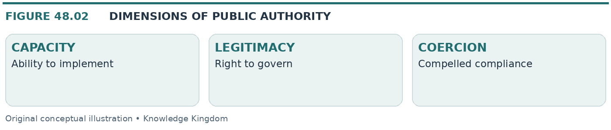

State capacity is the ability of institutions to carry out public decisions. It can include collecting revenue, delivering services, administering justice and implementing law. Legitimacy is the perception or normative claim that an authority has a right to govern. Coercion is the ability to impose compliance through force or threats. These three qualities interact but do not necessarily rise together.

A government might collect taxes efficiently while excluding a minority from political participation. Its administrative capacity may be considerable even while many inhabitants dispute its legitimacy. Another government may enjoy broad popular support after independence but lack the resources and trained officials needed to provide basic services. A third may dominate opponents through repression while failing to maintain a dependable judiciary. Asking whether each government is 'strong' conceals these important differences.

Legitimacy is also not a single national opinion. A municipal administration may be trusted because its employees know residents and deliver services reliably, while the national cabinet is widely distrusted. Citizens may regard a constitution as legitimate yet oppose the government currently acting under it. A survey conducted only in the capital may fail to reveal how other districts experience authority. Good analysis therefore asks: capacity to do what, legitimacy in whose eyes, and authority over which territory? \[<a href="/048-civil-wars-and-fragile-states/sources/#source-6" class="cite">6</a>\]\[<a href="/048-civil-wars-and-fragile-states/sources/#source-7" class="cite">7</a>\]

<figure class="figure" id="figure-48-2">

<figcaption>Figure 48.2. Capacity, legitimacy and coercion can vary independently. <a class="figure-anchor" href="#figure-48-2" aria-label="Link to this figure">#</a></figcaption>
</figure>
