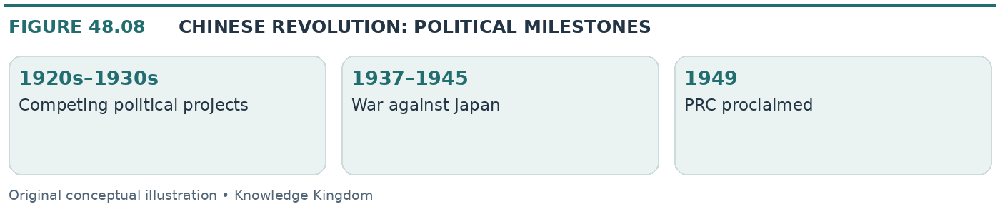

The Chinese Civil War between the Nationalists (Kuomintang) and Communists developed through several phases from the late 1920s to 1949, interrupted by periods of cooperation against Japanese invasion. The collapse of imperial institutions, struggles over political authority, rural inequality, foreign intervention and the devastation of the Sino-Japanese War all formed part of its context. \[<a href="/048-civil-wars-and-fragile-states/sources/#source-21" class="cite">21</a>\]

In 1949, the People's Republic of China was proclaimed on the mainland, while the Republic of China government relocated to Taiwan. The resulting political division remains a major international issue. The historical distinction between the end of the main phase of civil war on the mainland and the resolution of competing political claims is essential. One military and political outcome need not resolve all disputes about sovereignty or recognition.

The case is also a reminder that foreign invasion and internal political conflict can overlap. A chronology describing only two domestic parties would obscure the importance of Japanese imperial expansion and its consequences. A chronology concerned only with foreign invasion would overlook competing Chinese political projects. Historical causation frequently operates at several levels, and a careful account distinguishes each without pretending that one factor cancels the others.

<figure class="figure" id="figure-48-8">

<figcaption>Figure 48.8. Selected historical milestones, not a military chronology. <a class="figure-anchor" href="#figure-48-8" aria-label="Link to this figure">#</a></figcaption>
</figure>
