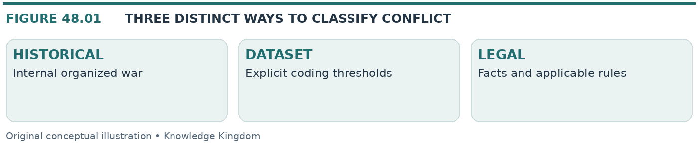

A civil war ordinarily means sustained organized armed conflict within a political community, commonly involving a state and organized challengers. Participants may seek control of government, autonomy for a region, secession, or a fundamental change in the political order. A conflict over government and a conflict over territory can overlap. Some wars involve several organizations whose goals change during the conflict. The adjective 'civil' does not mean civilized; nor does it mean that outsiders are absent.

The term is used differently by historians, lawyers and data researchers. The Uppsala Conflict Data Program (UCDP) has a specific category of state-based armed conflict: a dispute over government or territory, involving at least one state government and reaching 25 battle-related deaths in a calendar year. Its category of war uses a threshold of 1,000 such deaths in a year. Those thresholds are research conventions, not universal definitions of civil war and not legal tests for whether victims deserve protection. \[<a href="/048-civil-wars-and-fragile-states/sources/#source-1" class="cite">1</a>\]\[<a href="/048-civil-wars-and-fragile-states/sources/#source-2" class="cite">2</a>\]

Consider two fictional conflicts, each lasting three years. One meets the annual threshold every year; the other crosses it only in its second year. A dataset may count different numbers of active conflict-years even if both societies experience prolonged fear and disruption. If one researcher counts wars and another counts years of conflict, their graphs can differ without either being wrong. Before debating a trend, check what the unit actually represents.

Researchers also distinguish the beginning of a conflict, its duration, its termination and its recurrence. These are four related but different questions. A factor associated with the beginning of conflict may not explain why it lasts. A political agreement may bring an end to a particular conflict while another form of violence persists. Even a carefully constructed annual dataset cannot tell us whether individual families regard a period as peaceful. An analyst should resist the temptation to transform every statistical boundary into a historical turning point. \[<a href="/048-civil-wars-and-fragile-states/sources/#source-2" class="cite">2</a>\]\[<a href="/048-civil-wars-and-fragile-states/sources/#source-52" class="cite">52</a>\]

<figure class="figure" id="figure-48-1">

<figcaption>Figure 48.1. Historical, statistical and legal categories serve different purposes. <a class="figure-anchor" href="#figure-48-1" aria-label="Link to this figure">#</a></figcaption>
</figure>
