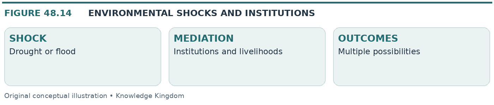

Drought, flooding, rising temperatures and environmental degradation can threaten agricultural livelihoods, increase food insecurity and strain public services. Yet it is misleading to say that climate change mechanically produces civil war. Similar environmental shocks can have very different consequences depending on institutions, economic alternatives, infrastructure, insurance, land governance and access to political remedies.

The IPCC's Sixth Assessment Report describes links between climate variability and conflict-related risks, including pathways through livelihood and food insecurity. It also distinguishes stronger evidence for some forms of low-intensity organized violence from evidence for major armed conflict. \[<a href="/048-civil-wars-and-fragile-states/sources/#source-41" class="cite">41</a>\] The important lesson is to examine mechanisms and uncertainty rather than use climate as a universal explanation for violence. A drought may make a political dispute harder to manage; it does not determine the choices of governments or armed groups.

Suppose two fictional farming regions experience the same reduction in rainfall. One has reliable irrigation, an independent dispute-resolution institution and income support during poor harvests. The other has unequal access to water, arbitrary land decisions and little social protection. The environmental shock is shared, but its social consequences differ. A useful policy response would therefore examine both climate adaptation and institutional fairness. A policy addressing rainfall while ignoring discrimination would overlook a major part of the problem, just as a policy addressing political representation while ignoring water scarcity might leave significant vulnerability untouched.

<figure class="figure" id="figure-48-14">

<figcaption>Figure 48.14. Environmental pressures do not determine political outcomes \[41\]. <a class="figure-anchor" href="#figure-48-14" aria-label="Link to this figure">#</a></figcaption>
</figure>
