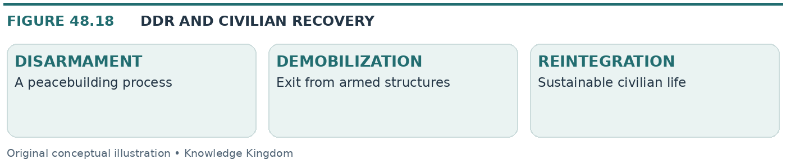

The acronym DDR refers to disarmament, demobilization and reintegration. In peacebuilding, these are related processes through which former members of armed organizations leave those structures and enter civilian life, within applicable agreements and legal frameworks. \[<a href="/048-civil-wars-and-fragile-states/sources/#source-46" class="cite">46</a>\] The social and institutional challenges extend far beyond the formal completion of any particular program.

A person may leave an armed organization but still lack a livelihood, education, housing or civil documentation. A receiving community may have experienced grave harm and may resent assistance perceived as benefiting former participants at the expense of victims. These are legitimate concerns that institutions must address fairly. Programs should therefore be evaluated not just by how many individuals have completed an administrative procedure but by whether people can obtain safe, lawful and sustainable livelihoods, and whether affected communities have access to services and remedies.

Security sector reform is a related but distinct task. It concerns the institutions responsible for security, their legal mandates, professional conduct, oversight and accountability. Restoring trust in police and other public institutions requires residents to be able to report abuse without fear and expect complaints to be investigated. Neither civilian reintegration nor reform of security institutions should be treated as a substitute for criminal accountability when serious crimes have occurred. Sustainable recovery requires public safety, individual rights and fair access to opportunities to be considered together.

<figure class="figure" id="figure-48-18">

<figcaption>Figure 48.18. DDR does not replace criminal accountability or community recovery. <a class="figure-anchor" href="#figure-48-18" aria-label="Link to this figure">#</a></figcaption>
</figure>
